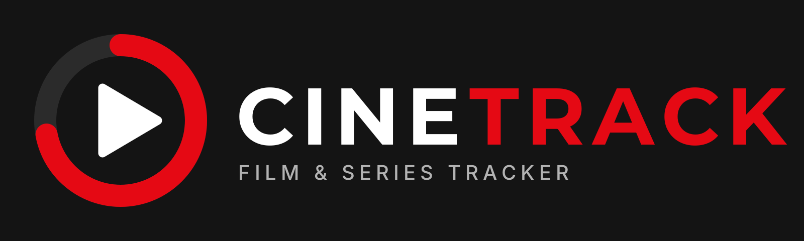
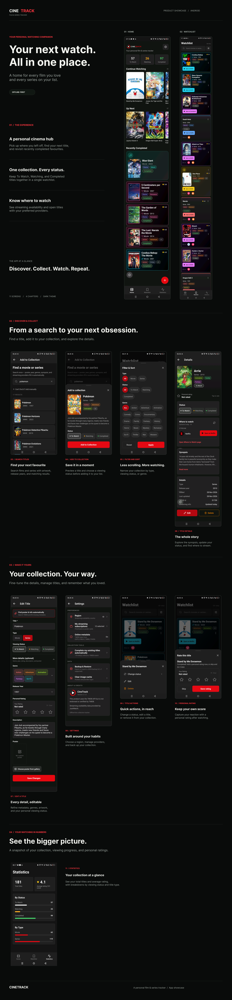
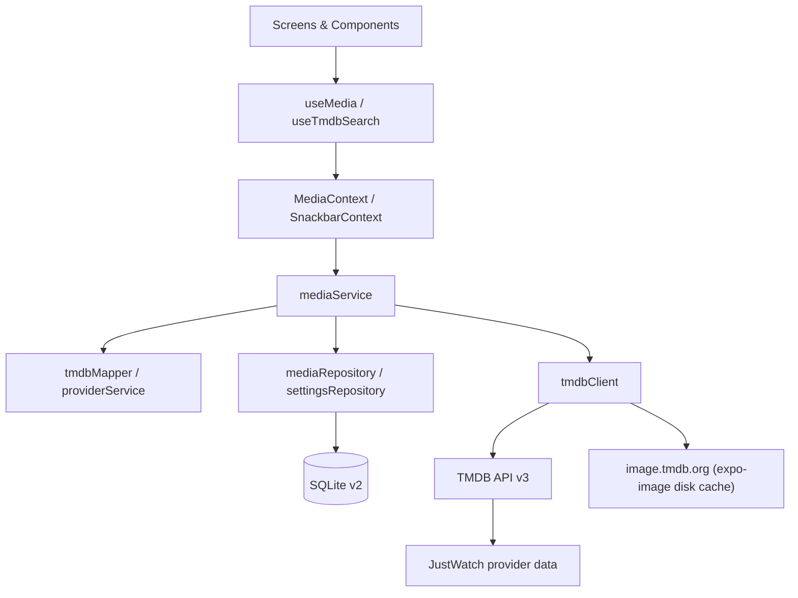

<p align="center">
  
</p>

# CineTrack

**Personal Film & Series Tracker — Version 2.1**


CineTrack is an offline-first mobile app for managing the movies and TV series you want to watch, are currently watching, or have already finished. The collection lives on the device in SQLite. TMDB is an **optional enrichment layer**: search a title once, and CineTrack fills in the poster, backdrop, genres, year, synopsis, and legal streaming providers. If the network or API token is unavailable, every core feature still works.

> **Version 2.1.** Responsive/adaptive UI release: edge-to-edge safe areas, shared keyboard-aware bottom sheets, keyboard-aware forms, FAB layering, and a star-based rating control. Version 2.0 introduced search-first add, automatic posters, genre-themed cards, where-to-watch data, Settings, enrichment, and backup v2.

## Table of Contents

- [Showcase / Tampilan Aplikasi](#showcase--tampilan-aplikasi)
- [Fitur](#fitur)
- [Fitur Lengkap (Detail)](#fitur-lengkap-detail)
- [Branding](#branding)
- [Tech Stack](#tech-stack)
- [Cara Menjalankan](#cara-menjalankan)
- [Panduan Setup Lengkap](#panduan-setup-lengkap)
- [Project Structure](#project-structure)
- [Architecture](#architecture)
- [Data Model](#data-model)
- [Documentation](#documentation)
- [Roadmap](#roadmap)
- [Scope & Limitations](#scope--limitations)
- [Credits & Attribution](#credits--attribution)
- [Development Workflow](#development-workflow)
- [Revision History](#revision-history)
- [License](#license)

---

## Showcase / Tampilan Aplikasi



*Gambar 1. Ringkasan tampilan aplikasi CineTrack.*

Gambar di atas memperlihatkan alur utama aplikasi: halaman utama, pencarian dan penambahan judul, detail tontonan, pengeditan, pengubahan status, serta aksi hapus.

| Layar | Penjelasan singkat |
| --- | --- |
| **Halaman utama (Home)** | Menampilkan ringkasan jumlah *To Watch*, *Watching*, dan *Completed*, carousel **Continue Watching**, **Up Next**, **Recently Completed**, serta tombol **+** untuk menambah tontonan dan ikon gear menuju Settings. |
| **Tambah tontonan** | Layar *Add to Collection* memfokuskan kolom pencarian TMDB. Setelah hasil dipilih, bottom sheet konfirmasi menampilkan poster, tahun, genre, sinopsis, pilihan status, dan rating opsional sebelum disimpan. Ada juga tautan **Can’t find it? Add manually** untuk mode offline. |
| **Detail tontonan** | Menampilkan poster/backdrop, judul, tipe dan tahun, genre, status, rating, **Where to watch**, sinopsis yang dapat dibuka, informasi tambahan, serta tombol **Edit** dan **Delete**. |
| **Edit / ubah status** | Form Edit memuat judul, tipe, status, dan bagian **More details (optional)** berisi genre, tahun, rating bintang, deskripsi, serta poster. Status juga dapat diubah langsung dari segmented control di Detail atau menu kartu. |
| **Hapus tontonan** | Tombol **Delete** selalu menampilkan dialog konfirmasi. Setelah dihapus, muncul snackbar **Undo** selama 5 detik; data dapat dikembalikan dan file poster lokal baru dihapus setelah masa Undo berakhir. |

## Fitur

CineTrack adalah aplikasi **To-Do List daftar tontonan** yang menyimpan data secara lokal di perangkat.

| Operasi | Implementasi di aplikasi |
| --- | --- |
| **Create (Tambah)** | Tambah lewat pencarian TMDB (search-first) atau form manual. Hanya **Title** yang wajib pada form manual; tipe default *Movie* dan status default *To Watch*. Metadata seperti poster, genre, tahun, sinopsis, dan provider dapat terisi otomatis dari TMDB. |
| **Read (Lihat)** | Home menampilkan ringkasan status dan carousel tontonan. Watchlist menampilkan seluruh koleksi dengan pencarian, filter tipe/status/genre, dan sorting. Detail menampilkan informasi lengkap satu judul. |
| **Update (Edit / Ubah Status)** | Edit membuka form yang sudah terisi. Status dapat diubah dari form, segmented control di Detail, atau menu **Change status** pada kartu. Mengubah status ke **Completed** memunculkan sheet rating yang bisa dilewati. |
| **Delete (Hapus)** | Delete meminta konfirmasi, menghapus baris dari SQLite, lalu menampilkan snackbar **Undo**. Aksi juga tersedia dari menu `⋯` pada kartu Watchlist. |

Status yang tersedia: **To Watch**, **Watching**, dan **Completed**. Rating pribadi memakai skala **1.0–5.0** dengan langkah 0.5. Fitur pendukung lain: statistik koleksi, backup/restore JSON, pengaturan region dan langganan streaming, serta enrichment data lama. Detail lengkap ada di bagian **Fitur Lengkap (Detail)**.

## Fitur Lengkap (Detail)

**Search-first collection**

- Tap **+** → type a title → tap a TMDB result → confirm status/rating → **Add to Collection**
- Poster, backdrop, genres, release year, synopsis, and streaming providers fill automatically
- “In collection” badge prevents accidental duplicates (`tmdb_id` + `type` is unique)
- “Can’t find it? Add manually” fallback keeps the app usable offline
- Friendly banners when offline or when `EXPO_PUBLIC_TMDB_TOKEN` is missing/invalid

**Posters**

- Remote TMDB posters cached on disk by `expo-image`
- Custom poster from the photo gallery (`expo-image-picker`), copied into app documents
- Genre-themed placeholder (gradient + icon + initials) when no image exists

**Streaming providers**

- Where to watch grouped by **Stream**, **Free & Ads**, **Rent**, and **Buy**
- Primary card button: **Open on {Provider}** (or **Rent/Buy on {Provider}**)
- Up to three additional provider logos on each card
- Provider availability cached in SQLite with a 7-day TTL; background refresh on app open
- Deep links use verified search templates where available, otherwise the TMDB/JustWatch “Where to watch” page

**Genre-themed cards**

- Four layout variants: `cinematic`, `poster`, `vibrant`, `atmospheric`
- Deterministic primary genre (e.g. Horror > Sci-Fi > Fantasy > … > Drama)
- Accent color and icon per genre; all variants expose the same information

**Organization & tracking**

- Search (case-insensitive, partial), filter by type/status/**genre**, sort by recent/title/rating/year
- Compact Watchlist header with a Filter & Sort bottom sheet and removable active-filter chips
- Overflow `⋯` menu on cards: Change status, Edit, Delete (long-press still works)
- Marking a title **Completed** offers a skippable quick rating sheet
- Delete with confirmation + **Undo** snackbar (data restored, local poster preserved for 6 seconds)
- Personal rating from 1.0 to 5.0

**Home & details**

- Tappable status summary, **Continue Watching**, **Up Next**, **Recently Completed**
- Hero backdrop + overlapping poster, tappable rating, status segmented control
- Where to watch with “Updated … ago” and refresh
- Collapsible synopsis and edit/delete actions

**Settings**

- Region (auto-detected, editable, ISO two-letter code)
- My streaming subscriptions (multi-select; affects card priority)
- Complete existing titles automatically with progress, cancel, and “Needs review”
- Backup & Restore (v2 export; v1 import supported)
- Clear image cache
- About & Credits with TMDB/JustWatch attribution

**Core**

- Add, edit, delete titles; track To Watch / Watching / Completed
- Statistics dashboard (totals, average rating, status and type breakdown)
- JSON backup/restore
- Single local user, no account, dark theme

---

## Branding

The CineTrack logo combines a white **play triangle** (watch/entertainment) inside a red **progress ring** (tracking progress through a watchlist). The mark works on its own or with the “CINETRACK” wordmark.

| Element | Value |
| --- | --- |
| Background | `#141414` |
| Primary accent | `#E50914` |
| Play mark | White |
| Wordmark | “CINETRACK” |

**Asset locations**

- App icon, adaptive icon layers, monotone icon, favicon: `assets/`
- Horizontal wordmark and standalone mark: `assets/images/logo-wordmark.png`, `assets/images/logo-mark.png`
- Editable SVG sources: `assets/branding/` (archive only, not bundled into the app)
- The native splash screen uses the mark on `#141414` via the `expo-splash-screen` config plugin.
- In-app branding uses `src/components/BrandLogo.js` on Home (wordmark) and Settings → About (mark).

---

## Tech Stack

| Technology | Purpose |
| --- | --- |
| React Native 0.88 / Expo SDK 58 | Mobile UI framework and runtime |
| JavaScript | Application language (no TypeScript) |
| React Navigation 7 | Bottom tabs + native stack |
| React Context + hooks | Shared collection, settings, snackbar |
| expo-sqlite | Local persistent database (v2 schema) |
| TMDB API v3 | Search, metadata, posters, watch providers |
| expo-image | Cached posters/backdrops/provider logos |
| expo-linear-gradient | Genre gradients and card overlays |
| expo-image-picker | Custom poster from gallery |
| expo-localization | Default region detection |
| expo-file-system | Copying/deleting custom poster files |
| expo-document-picker / expo-sharing | Backup export/import |
| expo-splash-screen | Native splash screen (logo mark, background `#141414`) |
| expo-status-bar | Status bar styling |
| Lucide React Native | Icons |
| StyleSheet | Styling (no UI kit) |
| jest-expo + jest | Unit tests for pure functions |

---

## Cara Menjalankan

Prasyarat: Node.js LTS, npm, Git, dan Expo Go di Android (opsional: akun TMDB).

```bash
npm install                 # pasang dependency
cp .env.example .env        # opsional; isi EXPO_PUBLIC_TMDB_TOKEN
npx expo start --clear      # jalankan Metro + Expo Go
```

Script yang tersedia di `package.json`:

```bash
npm start                   # sama dengan expo start
npm run android             # buka di Android
npm run ios                 # buka di iOS
npm run web                 # buka versi web
npm run lint                # ESLint
npm test                    # Jest
```

Build APK melalui EAS (profil `preview` menghasilkan APK internal):

```bash
npx eas-cli@latest build --profile preview --platform android
```

Token TMDB harus tersedia di environment EAS. Jika tidak ingin memakai fitur online, aplikasi tetap bisa dipakai untuk CRUD manual secara offline.

## Panduan Setup Lengkap

### Prerequisites

- Node.js LTS and npm
- Git
- An Android phone with **Expo Go** (SDK 58)
- Phone and computer on the same Wi-Fi network
- Optional: a free TMDB account for online features

### Installation

```bash
git clone https://github.com/<your-username>/CineTrack.git
cd CineTrack
npm install
```

Check SDK compatibility:

```bash
npx expo install --check
npx expo-doctor
```

### TMDB token (optional but recommended)

1. Create an account at <https://www.themoviedb.org/signup>.
2. Open <https://www.themoviedb.org/settings/api> and request an API key.
3. Copy the **API Read Access Token (Bearer)** — not the short API key.
4. Create `.env` from the example:

   ```bash
   cp .env.example .env
   ```

5. Fill in:

   ```env
   EXPO_PUBLIC_TMDB_TOKEN=eyJhbGciOi...
   ```

6. Restart with a clean cache:

   ```bash
   npx expo start --clear
   ```

If the token is missing or invalid, the app still runs. The Add screen shows an informational banner and directs you to the manual form.

> **Security note:** `EXPO_PUBLIC_*` variables are embedded in the client bundle. Anyone with the APK can extract the token. This is an accepted risk for this academic project. A production app should use a backend proxy that keeps the token server-side. See [`docs/14-external-api-integration.md`](docs/14-external-api-integration.md).

### EAS builds

The token must also exist in the EAS build environment; `.env` is not uploaded by default.

- EAS dashboard → your project → **Environment variables** → add `EXPO_PUBLIC_TMDB_TOKEN` for the `preview` and `production` environments.
- Or with EAS CLI:

  ```bash
  npx eas-cli@latest env:create \
    --name EXPO_PUBLIC_TMDB_TOKEN \
    --value "<your-token>" \
    --environment preview \
    --visibility sensitive
  ```

Build:

```bash
npx eas-cli@latest build --profile preview
```

`eas.json` defines an internal-distribution APK profile (`preview`) and a production profile.

### Run the app

```bash
npx expo start
```

Scan the QR code with Expo Go.

### Tests and quality checks

```bash
npm test              # jest-expo unit tests
npx expo lint         # ESLint (expo config)
npx expo-doctor       # dependency/config diagnostics
npx expo export --platform android   # production bundle smoke test
```

There is no `tsconfig.json`; the project is JavaScript-only.

### Troubleshooting

| Problem | Suggestion |
| --- | --- |
| QR scans but app won’t load | Same Wi-Fi; allow Node.js through the firewall |
| Dependency warnings | `npx expo install --check` then `npx expo install --fix` |
| Stale bundle or env change | `npx expo start --clear` |
| Online search always fails | Check `.env`, restart with `--clear`, verify the token is the **Read Access Token** |
| No providers for a country | Change region in Settings and refresh |
| Poster picker does not open | Ensure Expo Go has photo access in system settings |

---

## Project Structure

```
CineTrack/
├── __tests__/                     # Jest unit tests (pure functions)
├── assets/                        # App icons and splash assets
├── docs/                          # 01–15 project documentation
├── src/
│   ├── components/                # Reusable UI (cards, sheets, posters, providers)
│   ├── config/                    # Environment helpers (TMDB token)
│   ├── constants/                 # Colors, spacing, genres, themes, providers
│   ├── context/                   # MediaContext + SnackbarContext
│   ├── database/                  # Migrations + repositories
│   ├── hooks/                     # useMedia, useTmdbSearch, useSnackbar, …
│   ├── navigation/                # RootNavigator (stack) + TabNavigator
│   ├── screens/                   # Home, Watchlist, Add, ManualAdd, Details, Edit,
│   │                              # Statistics, Settings, Backup
│   ├── services/                  # mediaService, tmdbClient, tmdbMapper,
│   │                              # providerService, validationService
│   └── utils/                     # formatters, files, links
├── App.js
├── app.json
├── eas.json
├── jest.config.js
├── package.json
└── README.md
```

---

## Architecture

CineTrack keeps a strict layered flow. Screens and components never run SQL or call `fetch` directly.



- **SQLite is the source of truth.** Online results are mapped and persisted; cards render from SQLite.
- **Online is optional.** Add, manual add, edit, delete, status, rating, search/filter/sort, statistics, and backup work offline.
- **Provider cache** is stored per title (`providers_json`, `providers_region`, `providers_fetched_at`) with a 7-day TTL.
- **Images** are disk-cached by `expo-image`; custom posters live in the app documents directory.
- **Settings** (`region`, `subscriptions`) live in the `app_settings` table.

**Navigation:** a root native stack contains the bottom tabs (**Home**, **Watchlist**, **Statistics**) plus **AddMedia**, **ManualAdd**, **MediaDetails**, **EditMedia**, **Backup**, and **Settings**.

---

## Data Model

### `media` (v2)

| Field | Type | Required | Notes |
| --- | --- | --- | --- |
| `id` | INTEGER | Yes | Primary key, auto increment |
| `title` | TEXT | Yes | Must not be blank |
| `type` | TEXT | Yes | `MOVIE` or `SERIES` |
| `genre` | TEXT | No | Comma-separated genres (e.g. `Action, Sci-Fi`) |
| `release_year` | INTEGER | No | |
| `status` | TEXT | Yes | `TO_WATCH`, `WATCHING`, `COMPLETED` |
| `rating` | REAL | No | 1.0–5.0 |
| `description` | TEXT | No | Synopsis |
| `created_at` | TEXT | Yes | Creation timestamp |
| `updated_at` | TEXT | Yes | Updated by application logic |
| `tmdb_id` | INTEGER | No | TMDB id; unique together with `type` |
| `poster_path` | TEXT | No | TMDB poster path (portable) |
| `backdrop_path` | TEXT | No | TMDB backdrop path (portable) |
| `poster_uri` | TEXT | No | Local custom poster URI (not portable) |
| `tmdb_link` | TEXT | No | TMDB/JustWatch watch page |
| `providers_json` | TEXT | No | Normalized provider cache JSON |
| `providers_region` | TEXT | No | Region used for the cache |
| `providers_fetched_at` | TEXT | No | Cache timestamp (ISO 8601) |

`CREATE UNIQUE INDEX idx_media_tmdb ON media(tmdb_id, type) WHERE tmdb_id IS NOT NULL;`

### `app_settings`

| Key | Value example | Purpose |
| --- | --- | --- |
| `region` | `ID` | ISO 3166-1 alpha-2 streaming region |
| `subscriptions` | `[8,119]` | JSON array of TMDB provider ids prioritized on cards |

Migrations are versioned with `PRAGMA user_version`. Fresh installs create schema v2; upgrades from v1 only add columns/tables and preserve all rows. See [`docs/10-database-design.md`](docs/10-database-design.md) and [`docs/11-data-dictionary.md`](docs/11-data-dictionary.md).

---

## Documentation

| Phase | Document | Description |
| --- | --- | --- |
| 1 | [01-project-planning](docs/01-project-planning.md) | Scope, objectives, stack, risks, Definition of Done |
| 2 | [02-srs](docs/02-srs.md) | Software Requirements Specification (FR-01…FR-24) |
| 2 | [03-use-case](docs/03-use-case.md) | Use case diagram and UC-01…UC-21 |
| 2 | [04-requirement-traceability](docs/04-requirement-traceability.md) | RTM + test cases TC-001…TC-024 |
| 3 | [05-user-flow](docs/05-user-flow.md) | Search-first, filter, detail, settings flows |
| 3 | [06-wireframes](docs/06-wireframes.md) | Wireframes incl. four card variants |
| 3 | [07-activity-diagrams](docs/07-activity-diagrams.md) | Add, refresh, deep link, enrichment activities |
| 3 | [08-sequence-diagrams](docs/08-sequence-diagrams.md) | Online/offline sequences |
| 3 | [09-system-architecture](docs/09-system-architecture.md) | Layers, external systems, data flow |
| 3 | [10-database-design](docs/10-database-design.md) | ERD, v2 SQL, v1→v2 migration |
| 3 | [11-data-dictionary](docs/11-data-dictionary.md) | Every column, JSON formats, allowed values |
| 3 | [12-component-design](docs/12-component-design.md) | Components, props, genre→theme table |
| 4 | [13-implementation-plan](docs/13-implementation-plan.md) | Stack, milestones M1–M20, real status |
| 5 | [14-external-api-integration](docs/14-external-api-integration.md) | TMDB endpoints, mapping, cache, risks |
| 5 | [15-decision-log](docs/15-decision-log.md) | Design decisions and trade-offs |
| — | [CHANGELOG](CHANGELOG.md) | Release notes |

---

## Roadmap

The roadmap now reflects the actual code. All milestones below are implemented.

| Milestone | Task | Priority | Status |
| --- | --- | --- | --- |
| M1 | Project initialization | Must | Done |
| M2 | Install dependencies | Must | Done |
| M3 | Folder structure | Must | Done |
| M4 | Theme & reusable components | Must | Done |
| M5 | Navigation setup | Must | Done |
| M6 | SQLite initialization | Must | Done |
| M7 | Create & Read | Must | Done |
| M8 | Update & Delete | Must | Done |
| M9 | Search & Filter | Must | Done |
| M10 | Rating functionality | Must | Done |
| M11 | Statistics | Should | Done |
| M12 | Sorting | Could | Done |
| M13 | Testing & bug fixing | Must | Done (unit tests, migration test, bundle) |
| M14 | Database v2 migration | Must | Done |
| M15 | TMDB service & genre mapping | Must | Done |
| M16 | Search-first Add flow | Must | Done |
| M17 | Posters & genre-themed cards | Must | Done |
| M18 | Home, Watchlist, Detail UX | Must | Done |
| M19 | Settings, enrichment, background refresh | Should | Done |
| M20 | Documentation & QA | Must | Done |

---

## Scope & Limitations

CineTrack is intentionally small and focused.

- Single local user; no registration or login.
- Core features are fully offline. Online enrichment requires internet and a TMDB token, and fails safely.
- **The app does not stream or distribute content.** “Open on …” only opens a legal platform page or the TMDB/JustWatch watch page.
- Streaming availability is region-specific and comes from TMDB/JustWatch. It can lag behind the real world.
- TMDB does not provide per-title deep links for every provider. Verified search templates are used where possible; otherwise the app opens the TMDB/JustWatch page.
- Provider list coverage depends on the region dataset. WeTV, iQIYI, and Paramount+ were not present in the verified `watch_region=ID` dataset at implementation time; if they appear in a future response they are displayed automatically with the fallback link.
- `EXPO_PUBLIC_TMDB_TOKEN` is bundled in the client. A backend proxy is the production-grade alternative.
- No cloud sync. Backup/restore is a manual JSON file; backup v2 excludes local poster paths and provider caches.
- Data exists only on the device where the app is installed.
- Target platform: Android via Expo Go; iOS is supported by the same React Native code but is not the primary test target.

---

## Credits & Attribution

This product uses the TMDB API but is not endorsed or certified by TMDB.

Streaming availability data provided by JustWatch.

TMDB: <https://www.themoviedb.org/> · JustWatch: <https://www.justwatch.com/>

TMDB and JustWatch trademarks belong to their respective owners. The app displays text attribution only (no TMDB logo assets are bundled).

---

## Known Limitations & Tested Devices

**Layout behavior**

- Android is edge-to-edge: screens apply safe-area insets for status/navigation bars, and the tab bar owns its bottom inset.
- All bottom sheets use the shared `BottomSheet` (`Modal` + nested `SafeAreaProvider` + keyboard height + sticky footer + max width 640).
- Form screens use `ScreenContainer` (KAV `behavior="padding"` on Android and iOS). The FAB is a last-sibling absolute overlay with high z-order/elevation and is hidden while the keyboard is open.
- Content is capped at `MAX_CONTENT_WIDTH` (640 dp) on tablets/foldables; carousel cards are computed from `useWindowDimensions` (140–200 dp).
- Snackbar sits above the FAB and tab bar.

**What was actually verified**

- `npx expo lint`, `npm test`, `npx expo-doctor`, `npx expo install --check`, and `npx expo export --platform android` on Linux.
- Database migration and unique-index tests with `node:sqlite`.
- Mermaid/document-link validation.
- No physical Android device or emulator was attached to the development environment. The four bug reports were reproduced from the user’s Android screenshots (3-button navigation, portrait, 720×1600 px).
- Not yet device-verified: gesture navigation, system font size “Largest”, display size “Largest”, small 360×640 dp screens, tablet/foldable widths, 100+ item scroll performance, and the live keyboard/sheet matrix. These are tracked as TC-027…TC-036 in [`docs/04-requirement-traceability.md`](docs/04-requirement-traceability.md).

## Tautan

- **Desain Figma:** [CineTrack — Figma](https://www.figma.com/design/RnqNxjYUFNRiUCFMjcKQyK/CineTrack?m=auto&t=Rd4cobCvO2tSjig4-1)
- **Unduh APK & dokumentasi:** [Google Drive — CineTrack](https://drive.google.com/drive/folders/1WtZNzAg6mGBET3QzDshiB2M4Zs5fHiaJ?usp=sharing)

## Pembuat

**Aldo Kristian**  
NPM **2532015**  
Program Studi **Teknologi Informasi**  
**Universitas Internasional Batam**  
Mata Kuliah **Lab. Pemrograman Mobile**

## Development Workflow

- `main` contains a stable version.
- Each phase/feature is committed separately.
- Lint, tests, doctor, and a bundle smoke test run before a task is declared done.
- Commit messages follow `feat:`, `fix:`, `docs:`, `refactor:`.

```bash
npm test
npx expo lint
npx expo-doctor
npx expo export --platform android
```

---

## Revision History

| Version | Date | Summary | Reason |
| --- | --- | --- | --- |
| 2.1.0 | 2026-11-28 | Responsive/adaptive layout: shared BottomSheet, ScreenContainer, keyboard hook, safe-area audit, FAB layering, star rating, max-width and font-scaling guards | Perbaikan responsive UI |
| 2.0.0 | 2026-11-28 | Search-first add, TMDB metadata/posters/providers, genre-themed cards, Home/Watchlist/Detail redesign, Settings, enrichment, backup v2, branding/logo, full docs revision | Lecturer consultation + UX fixes |
| 1.0.0 | 2026-11-25 | Initial offline CRUD, search/filter/sort, rating, statistics, backup | Initial release |

---

## License

This project is developed for academic and learning purposes. Add a license of your choice (for example MIT) before publishing publicly.

---

**CineTrack 2.1** — built with React Native, Expo, SQLite, and optional TMDB enrichment.
