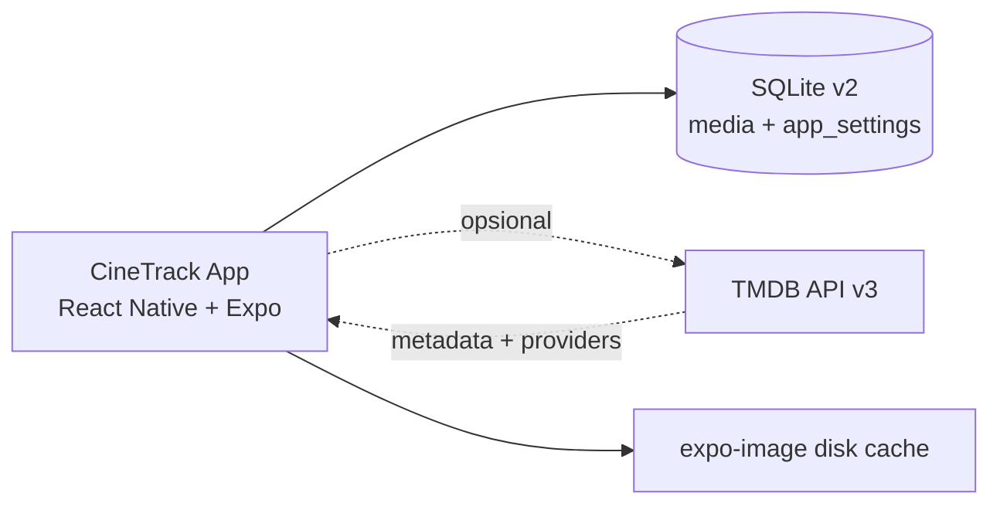

# Phase 1 — Project Planning

**Document ID:** CT-PLAN-001\
**Version:** 2.0\
**Status:** Final\
**Project:** CineTrack\
**Platform:** Android (React Native + Expo)\
**Last updated:** 2026-11-28

Phase 1 menetapkan fondasi proyek: masalah, tujuan, ruang lingkup, batasan, teknologi, model data awal, risiko, dan Definition of Done. Dokumen ini menjadi acuan untuk SRS, diagram, wireframe, implementasi, dan pengujian.

## Revision History

| Version | Date | Ringkasan perubahan | Alasan |
| --- | --- | --- | --- |
| 2.0 | 2026-11-28 | Menambahkan TMDB dalam scope, poster otomatis, streaming provider, kartu per genre, Settings, enrichment, identitas visual/logo, dan revisi NFR-01 | Hasil konsultasi dosen + perbaikan UX |
| 1.0 | 2026-11-25 | Dokumen perencanaan awal (offline-only) | Inisialisasi proyek |

---

## 1.1 Project Overview

# CineTrack

**Personal Film & Series Tracker — v2**

| Informasi | Detail |
| --- | --- |
| Project Name | CineTrack |
| Project Type | Mobile Application |
| Platform | Android (utama), iOS kompatibel |
| Framework | React Native 0.88 |
| Development Tool | Expo SDK 58 / Expo Go |
| Language | JavaScript |
| Navigation | React Navigation (stack + bottom tabs) |
| Storage | SQLite lokal (expo-sqlite), schema v2 |
| Online enrichment | TMDB API v3 (opsional) |
| UI Theme | Dark (gaya Netflix) |
| Complexity | Balanced |
| Application Model | Single-user, offline-first |
| Main Purpose | Personal watchlist + metadata/poster/streaming enrichment |

**Deskripsi proyek**

CineTrack membantu pengguna mencatat film dan serial yang ingin ditonton, sedang ditonton, atau sudah selesai. Pengguna dapat mengelola status, rating pribadi, pencarian, filter, sorting, statistik, dan backup.

Versi 2 menjawab tiga kebutuhan utama dari konsultasi dosen:

1. **Poster/thumbnail judul secara otomatis** (TMDB), dengan fallback manual dan placeholder bertema genre.
2. **Informasi platform streaming legal** pada kartu, dengan tombol “Open on …”.
3. **Tampilan kartu yang bervariasi berdasarkan genre.**

Selain itu, alur tambah diubah menjadi **search-first**: cukup ketik judul, pilih hasil, lalu simpan. Metadata terisi otomatis.

Prinsip offline-first dipertahankan: seluruh fitur inti berjalan tanpa internet. TMDB adalah lapisan pengayaan opsional. Semua hasil online disimpan di SQLite agar tetap tampil saat offline.

---

## 1.2 Problem Statement

**Masalah pengguna**

1. Pengguna sering lupa judul film/serial yang ingin ditonton.
2. Daftar tontonan tersebar di catatan, chat, dan aplikasi lain.
3. Sulit membedakan status belum ditonton, sedang ditonton, dan selesai.
4. Tidak ada catatan terpusat untuk tontonan dan rating pribadi.
5. Pengguna harus mencari manual di beberapa platform streaming untuk mengetahui di mana judul tersedia.

**Masalah UX pada versi 1**

1. Menambah satu judul membutuhkan banyak langkah: mengetik judul, memilih tipe, genre, tahun, status, rating, deskripsi, lalu memilih poster.
2. Header Watchlist menumpuk empat kontrol (search, tipe, status, sort) sehingga memakan ruang layar.
3. Aksi edit/hapus hanya dapat ditemukan lewat long-press.
4. Mengubah status ke **Completed** tidak mengarahkan pengguna untuk memberi rating.
5. Tidak ada poster; kartu terlihat seragam dan sulit dipindai.
6. Dokumentasi masih menyatakan aplikasi sepenuhnya offline dan tidak memakai sumber data eksternal, tidak sesuai kebutuhan dan kode.

**Problem statement**

Belum adanya pengelolaan watchlist yang sederhana, cepat, dan terorganisasi menyulitkan pengguna mencatat, melacak, memberi rating, serta menemukan platform legal untuk menonton film dan serial.

---

## 1.3 Project Objectives

1. Menyediakan tempat penyimpanan koleksi film/serial yang terpusat dan persisten.
2. Menyediakan operasi CRUD, status, rating, search, filter (termasuk genre), sort, dan statistik.
3. Mempercepat alur tambah menjadi **judul → hasil → simpan**.
4. Mengisi metadata dan poster secara otomatis dari TMDB.
5. Menampilkan ketersediaan streaming legal per region dan tombol buka platform.
6. Menampilkan kartu yang bervariasi berdasarkan genre utama.
7. Menyediakan Settings untuk region, langganan streaming, enrichment data lama, backup, dan cache.
8. Mempertahankan pengalaman offline-first: fitur inti tetap berfungsi tanpa internet.
9. Menyediakan dokumentasi dan pengujian yang konsisten dengan kode nyata.

---

## 1.4 Target Users

- Pengguna yang gemar menonton film dan serial.
- Pengguna yang ingin memiliki watchlist pribadi tanpa registrasi.
- Pengguna yang ingin melacak riwayat dan rating pribadi.
- Pengguna yang ingin tahu di platform legal mana sebuah judul tersedia.
- Mahasiswa/dosen yang mengevaluasi implementasi React Native + SQLite + API eksternal.

Aplikasi ini **bukan** layanan streaming dan tidak mendistribusikan konten.

---

## 1.5 Project Scope

### A. Functional Scope

**Core / Must**

| ID | Fitur | Deskripsi |
| --- | --- | --- |
| FR-01 | View Collection | Menampilkan seluruh koleksi dan ringkasan status |
| FR-02 | Add Item | Menambah film/serial (online atau manual) |
| FR-03 | Edit Item | Mengubah informasi tontonan |
| FR-04 | Delete Item | Menghapus tontonan dengan konfirmasi dan Undo |
| FR-05 | Status Management | To Watch / Watching / Completed |
| FR-06 | View Details | Hero, metadata, sinopsis, where to watch |
| FR-07 | Search Collection | Pencarian judul/genre di koleksi |
| FR-08 | Type Filter | Movie / Series |
| FR-09 | Status Filter | Filter status |
| FR-10 | Personal Rating | Rating 1–5, bisa diubah dari detail |

**Should / Could**

| ID | Fitur | Deskripsi |
| --- | --- | --- |
| FR-11 | Dashboard Statistics | Total, rata-rata rating, status, tipe |
| FR-12 | Empty States & Feedback | Empty/loading/error state, snackbar |
| FR-13 | Sort Collection | Recent, Title A–Z, Rating, Year |
| FR-14 | Search Title Online | Pencarian TMDB (debounce 400 ms, min 2 karakter) |
| FR-15 | Auto-fill Metadata | Poster, backdrop, genre, tahun, sinopsis, provider |
| FR-16 | Poster/Thumbnail | Otomatis TMDB + manual galeri + placeholder genre |
| FR-17 | Streaming Availability | Provider per region, dikelompokkan Stream/Free/Rent/Buy |
| FR-18 | Open on Platform | Template terverifikasi atau fallback TMDB/JustWatch |
| FR-19 | Genre-themed Card | 4 varian layout + aksen/ikon genre |
| FR-20 | Quick Status & Rating Prompt | Rating sheet setelah Completed |
| FR-21 | Genre Filter | Filter genre di Watchlist |
| FR-22 | Settings | Region, subscriptions, cache, about |
| FR-23 | Enrich Existing Data | Auto-match judul lama + Needs review |
| FR-24 | Backup v2 | Export/import JSON; kompatibel backup v1 |

### B. Non-Functional Scope

| ID | Requirement | Target |
| --- | --- | --- |
| NFR-01 | Offline degradation | Fitur inti 100% offline; fitur online gagal dengan aman |
| NFR-02 | Data persistence | Data bertahan setelah app ditutup |
| NFR-03 | Performance | List 100+ item dengan gambar tetap responsif |
| NFR-04 | Usability | Alur tambah ≤ 4 tap + mengetik; touch target ≥ 44 dp |
| NFR-05 | Consistency | Dark theme, spacing, typography konsisten |
| NFR-06 | Data integrity | Validasi input; migrasi transaksional; unique `(tmdb_id,type)` |
| NFR-07 | Compatibility | Expo Go SDK 58, Android utama |
| NFR-08 | Maintainability | Layered architecture; screen tanpa SQL/fetch |
| NFR-09 | Error handling | Timeout 8 s, 1 retry jaringan, pesan ramah |
| NFR-10 | Attribution | TMDB + JustWatch ditampilkan di Settings/About & README |
| NFR-11 | Security (accepted risk) | Token klien; alternatif proxy didokumentasikan |

### C. Out of Scope

- Registrasi/login dan multi-user.
- Streaming, download, atau distribusi konten.
- Cloud sync otomatis.
- Pembayaran/langganan di dalam aplikasi.
- Rekomendasi berbasis ML.
- Deep link per judul untuk semua provider (TMDB tidak menyediakannya).
- Backend proxy (disebut sebagai future work, bukan implementasi).

---

## 1.6 Project Limitations

1. Satu pengguna lokal; tidak ada akun.
2. Tidak ada sinkronisasi cloud; backup manual berupa file JSON.
3. Tidak memutar konten; hanya membuka platform legal.
4. Fitur online membutuhkan internet dan token TMDB yang valid.
5. Kualitas data provider bergantung pada TMDB/JustWatch dan region.
6. Template deep link hanya dipakai jika sudah diverifikasi; sisanya fallback.
7. `EXPO_PUBLIC_TMDB_TOKEN` ikut terbundel di klien.
8. Data hanya ada di perangkat tempat aplikasi diinstal.
9. Target utama Android; iOS mengikuti kode React Native yang sama.

---

## 1.7 Technology Stack

| Technology | Penggunaan |
| --- | --- |
| React Native 0.88 | Mobile UI |
| Expo SDK 58 | Development environment/runtime |
| Expo Go | Menjalankan aplikasi saat pengembangan |
| JavaScript | Bahasa pemrograman |
| React Navigation 7 | Stack + bottom tabs |
| React Context + hooks | State koleksi, settings, snackbar |
| SQLite / expo-sqlite | Database lokal v2 |
| TMDB API v3 | Search, detail, poster, watch providers |
| expo-image | Poster/backdrop/logo + disk cache |
| expo-linear-gradient | Gradient tema genre |
| expo-image-picker | Poster manual dari galeri |
| expo-localization | Deteksi region awal |
| expo-file-system | Copy/hapus file poster |
| expo-document-picker + expo-sharing | Backup/restore |
| StyleSheet | Styling |
| Lucide React Native | Ikon |
| jest-expo + jest | Unit test fungsi murni |
| Git & GitHub | Version control |

**Arsitektur penyimpanan & data**

Data inti disimpan lokal. TMDB hanya sumber pengayaan; hasilnya dipersist ke SQLite.

---

## 1.7a Identitas Visual

Logo CineTrack adalah **segitiga play putih** di dalam **cincin progres merah** (`#E50914`) pada latar `#141414`.

- **Play** melambangkan tontonan/film dan serial.
- **Cincin progres** melambangkan tracking status tontonan (To Watch → Watching → Completed).
- Palet utama: `#141414` (background) dan `#E50914` (aksen utama), dengan play mark putih.

Aset:

| Kebutuhan | Lokasi |
| --- | --- |
| App icon | `assets/icon.png` |
| Android adaptive icon | `assets/android-icon-foreground.png`, `assets/android-icon-background.png`, `assets/android-icon-monochrome.png` |
| Favicon web | `assets/favicon.png` |
| Logo dalam aplikasi | `assets/images/logo-mark.png`, `assets/images/logo-wordmark.png` |
| Arsip SVG sumber (tidak dibundel) | `assets/branding/*.svg` |

Native splash memakai `logo-mark.png` di atas `#141414` melalui plugin `expo-splash-screen`. Branding dalam aplikasi memakai komponen `BrandLogo` (Home: wordmark; Settings/About: mark).

---

## 1.8 Initial Data Model

Model awal v2 (detail final di `docs/10` dan `docs/11`):

**Tabel `media`**

| Attribute | Data Type | Description |
| --- | --- | --- |
| id | INTEGER | Primary key |
| title | TEXT | Judul film/serial |
| type | TEXT | MOVIE / SERIES |
| genre | TEXT | Comma-separated genre |
| release_year | INTEGER | Tahun rilis |
| status | TEXT | TO_WATCH / WATCHING / COMPLETED |
| rating | REAL | Rating pribadi 1–5 |
| description | TEXT | Sinopsis |
| created_at | TEXT | Waktu dibuat |
| updated_at | TEXT | Waktu diperbarui |
| tmdb_id | INTEGER | ID TMDB (unik per type) |
| poster_path | TEXT | Path poster TMDB |
| backdrop_path | TEXT | Path backdrop TMDB |
| poster_uri | TEXT | URI poster lokal pilihan user |
| tmdb_link | TEXT | Link TMDB/JustWatch |
| providers_json | TEXT | Cache provider ternormalisasi |
| providers_region | TEXT | Region cache |
| providers_fetched_at | TEXT | Waktu fetch cache |

**Tabel `app_settings`**

| Key | Value | Description |
| --- | --- | --- |
| region | `ID` | Region streaming |
| subscriptions | `[8,119]` | Provider ID yang diprioritaskan |

---

## 1.9 Project Constraints & Risks

| Risiko / Kendala | Dampak | Penanganan |
| --- | --- | --- |
| Ketergantungan TMDB | Fitur online mati jika API berubah/down | Wrapper tunggal, fallback manual, cache SQLite |
| Rate limit / 429 | Pencarian gagal sementara | Pesan “Try again in a moment”, retry terbatas |
| Token klien terbundel | Token bisa diekstrak | Risiko diterima untuk akademik; proxy didokumentasikan |
| Kualitas data provider per negara | Provider bisa tidak lengkap/berubah | Region dapat diubah; fallback link TMDB |
| Perubahan URL deep link | Tombol provider bisa gagal | Template diverifikasi; fallback; alert |
| Data lama hilang saat migrasi | Kehilangan koleksi user | Migrasi transaksional + tes v1→v2 |
| Scope terlalu luas | Proyek tidak selesai | Prioritas Must, fase bertahap |
| Performa list + gambar | Jank pada Android menengah | React.memo, FlatList tuning, image cache |
| Expo SDK berubah | API tidak cocok | `npx expo install`, docs versi SDK 58 |
| User menolak metadata otomatis menimpa data | Data pribadi hilang | Auto-apply hanya exact match; field user dipertahankan |

---

## 1.10 Definition of Done

Versi 2 dianggap selesai jika:

- Pengguna dapat menambah judul dari TMDB dengan ≤ 4 tap + mengetik.
- Poster, genre, tahun, sinopsis, dan provider terisi otomatis.
- Duplikat `tmdb_id` + `type` ditolak dengan pesan ramah.
- Mode offline/token kosong menampilkan banner dan form manual tetap berfungsi.
- Minimal 4 varian kartu muncul sesuai genre (Horror, Comedy, Action, Drama).
- Placeholder bertema genre tampil tanpa poster.
- Tombol “Open on …” membuka platform/fallback tanpa crash.
- Watchlist memiliki search + Filter sheet + chip filter aktif.
- Aksi `⋯` (status/edit/delete) berfungsi; Completed memunculkan rating sheet.
- Detail menampilkan hero, where to watch + refresh, sinopsis expandable.
- Settings mengubah region, subscriptions, enrichment, cache, atribusi.
- Upgrade DB v1 → v2 tidak kehilangan data.
- Backup v2 diekspor/diimpor; backup v1 tetap bisa diimpor.
- Lint, test, doctor, dan bundle Android lulus.
- Semua dokumen v2.0 konsisten dengan kode.

---

## 1.11 Phase 1 Deliverables

- Project overview, problem statement, objectives
- Target users dan scope in/out
- Limitations, tech stack, initial data model
- Constraints & risks
- Definition of Done
- Revision history

**End of Document**

Document ID: CT-PLAN-001\
Version: 2.0\
Project: CineTrack
