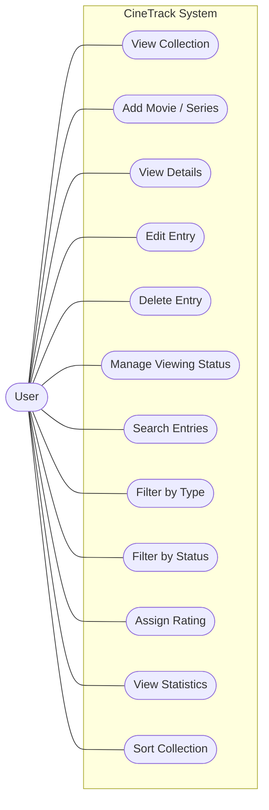

# CineTrack — Use Case Specification

## 1. Actors

| Actor | Description                                                         |
| ----- | ------------------------------------------------------------------- |
| User  | The primary user who manages personal movie and series collections. |

## 2. Use Case Diagram

## 3. Use Case List

| ID    | Use Case         | Description                       |
| ----- | ---------------- | --------------------------------- |
| UC-01 | View Collection  | View saved movies and series      |
| UC-02 | Add Entry        | Add a new movie or series         |
| UC-03 | View Details     | View complete entry information   |
| UC-04 | Edit Entry       | Modify existing information       |
| UC-05 | Delete Entry     | Remove an entry                   |
| UC-06 | Manage Status    | Change viewing status             |
| UC-07 | Search Entries   | Search by title                   |
| UC-08 | Filter by Type   | Filter movies or series           |
| UC-09 | Filter by Status | Filter by viewing status          |
| UC-10 | Assign Rating    | Assign a personal rating          |
| UC-11 | View Statistics  | View collection statistics        |
| UC-12 | Sort Collection  | Sort entries by selected criteria |

## 4. Detailed Use Case Descriptions

### UC-01 — View Collection

| Attribute        | Description                                                                                                      |
| ---------------- | ---------------------------------------------------------------------------------------------------------------- |
| Primary Actor    | User                                                                                                             |
| Preconditions    | Application is opened                                                                                            |
| Trigger          | User opens the collection screen                                                                                 |
| Main Flow        | 1. User opens the application. 2. System retrieves saved entries from SQLite. 3. System displays the collection. |
| Alternative Flow | If no entries exist, the system displays an empty state.                                                         |
| Postconditions   | Collection is displayed.                                                                                         |

### UC-02 — Add Entry

| Attribute        | Description                                                                                                                                                                                                     |
| ---------------- | --------------------------------------------------------------------------------------------------------------------------------------------------------------------------------------------------------------- |
| Primary Actor    | User                                                                                                                                                                                                            |
| Preconditions    | Application is running                                                                                                                                                                                          |
| Trigger          | User selects Add                                                                                                                                                                                                |
| Main Flow        | 1. System displays the entry form. 2. User enters the required information. 3. User submits the form. 4. System validates the input. 5. System saves the entry to SQLite. 6. System displays a success message. |
| Alternative Flow | If required fields are invalid, the system displays validation errors.                                                                                                                                          |
| Postconditions   | New entry is stored in SQLite.                                                                                                                                                                                  |

### UC-03 — View Details

| Attribute        | Description                                                                                          |
| ---------------- | ---------------------------------------------------------------------------------------------------- |
| Primary Actor    | User                                                                                                 |
| Preconditions    | At least one entry exists                                                                            |
| Trigger          | User selects an entry                                                                                |
| Main Flow        | 1. User selects an entry. 2. System retrieves its information. 3. System displays the detail screen. |
| Alternative Flow | If the entry is no longer available, the system displays an appropriate message.                     |
| Postconditions   | Entry details are displayed.                                                                         |

### UC-04 — Edit Entry

| Attribute        | Description                                                                                                                                                                           |
| ---------------- | ------------------------------------------------------------------------------------------------------------------------------------------------------------------------------------- |
| Primary Actor    | User                                                                                                                                                                                  |
| Preconditions    | Entry exists                                                                                                                                                                          |
| Trigger          | User selects Edit                                                                                                                                                                     |
| Main Flow        | 1. System displays the editing form. 2. Existing information is loaded. 3. User modifies information. 4. User saves changes. 5. System validates the input. 6. System updates SQLite. |
| Alternative Flow | Invalid input prevents the update.                                                                                                                                                    |
| Postconditions   | Entry information is updated.                                                                                                                                                         |

### UC-05 — Delete Entry

| Attribute        | Description                                                                                                                                                       |
| ---------------- | ----------------------------------------------------------------------------------------------------------------------------------------------------------------- |
| Primary Actor    | User                                                                                                                                                              |
| Preconditions    | Entry exists                                                                                                                                                      |
| Trigger          | User selects Delete                                                                                                                                               |
| Main Flow        | 1. User selects Delete. 2. System displays confirmation. 3. User confirms deletion. 4. System deletes the record from SQLite. 5. System refreshes the collection. |
| Alternative Flow | If the user cancels, no data is deleted.                                                                                                                          |
| Postconditions   | Entry is removed from the collection and database.                                                                                                                |

### UC-06 — Manage Viewing Status

| Attribute        | Description                                                                                                            |
| ---------------- | ---------------------------------------------------------------------------------------------------------------------- |
| Primary Actor    | User                                                                                                                   |
| Preconditions    | Entry exists                                                                                                           |
| Trigger          | User selects a new status                                                                                              |
| Main Flow        | 1. User opens an entry. 2. User selects a status. 3. System updates the record. 4. System displays the updated status. |
| Alternative Flow | If the update fails, the system displays an error message.                                                             |
| Postconditions   | Viewing status is updated.                                                                                             |

### UC-07 — Search Entries

| Attribute        | Description                                                                                                      |
| ---------------- | ---------------------------------------------------------------------------------------------------------------- |
| Primary Actor    | User                                                                                                             |
| Preconditions    | Collection screen is available                                                                                  |
| Trigger          | User enters a search query                                                                                       |
| Main Flow        | 1. User enters a title or partial title. 2. System searches the collection. 3. System displays matching entries. |
| Alternative Flow | If no matches exist, the system displays a no-results message.                                                   |
| Postconditions   | Matching entries are displayed.                                                                                  |

### UC-08 — Filter by Type

| Attribute        | Description                                                                                                   |
| ---------------- | ------------------------------------------------------------------------------------------------------------- |
| Primary Actor    | User                                                                                                          |
| Preconditions    | Collection screen is available                                                                                |
| Trigger          | User selects a content type filter                                                                            |
| Main Flow        | 1. User selects Movie, Series, or All. 2. System filters the collection. 3. System displays matching entries. |
| Alternative Flow | If no entries match, an empty result message appears.                                                         |
| Postconditions   | Collection is filtered by type.                                                                               |

### UC-09 — Filter by Status

| Attribute        | Description                                                                                              |
| ---------------- | -------------------------------------------------------------------------------------------------------- |
| Primary Actor    | User                                                                                                     |
| Preconditions    | Collection screen is available                                                                           |
| Trigger          | User selects a status filter                                                                             |
| Main Flow        | 1. User selects a viewing status. 2. System filters the collection. 3. System displays matching entries. |
| Alternative Flow | If no entries match, an empty result message appears.                                                    |
| Postconditions   | Collection is filtered by status.                                                                        |

### UC-10 — Assign Rating

| Attribute        | Description                                                                                                                                       |
| ---------------- | ------------------------------------------------------------------------------------------------------------------------------------------------- |
| Primary Actor    | User                                                                                                                                              |
| Preconditions    | Entry exists                                                                                                                                      |
| Trigger          | User selects a rating                                                                                                                             |
| Main Flow        | 1. User opens an entry or its editing form. 2. User selects a rating between 1 and 5. 3. System validates the rating. 4. System saves the rating. |
| Alternative Flow | An invalid rating is rejected.                                                                                                                    |
| Postconditions   | Personal rating is stored.                                                                                                                        |

### UC-11 — View Statistics

| Attribute        | Description                                                                                                 |
| ---------------- | ----------------------------------------------------------------------------------------------------------- |
| Primary Actor    | User                                                                                                        |
| Preconditions    | Collection screen is available                                                                              |
| Trigger          | User opens the statistics section                                                                           |
| Main Flow        | 1. System retrieves collection data. 2. System calculates collection totals. 3. System displays statistics. |
| Alternative Flow | If no data exists, all totals are zero.                                                                     |
| Postconditions   | Collection statistics are displayed.                                                                        |

### UC-12 — Sort Collection

| Attribute        | Description                                                                                                 |
| ---------------- | ----------------------------------------------------------------------------------------------------------- |
| Primary Actor    | User                                                                                                        |
| Preconditions    | Collection screen is available                                                                              |
| Trigger          | User selects a sorting option                                                                               |
| Main Flow        | 1. User selects a sorting criterion. 2. System sorts the collection. 3. System displays the sorted entries. |
| Alternative Flow | If the collection is empty, no sorting is performed.                                                        |
| Postconditions   | Collection is displayed in the selected order.                                                              |

---

**End of Document**

Document ID: CT-UC-001\
Version: 1.0\
Project: CineTrack
