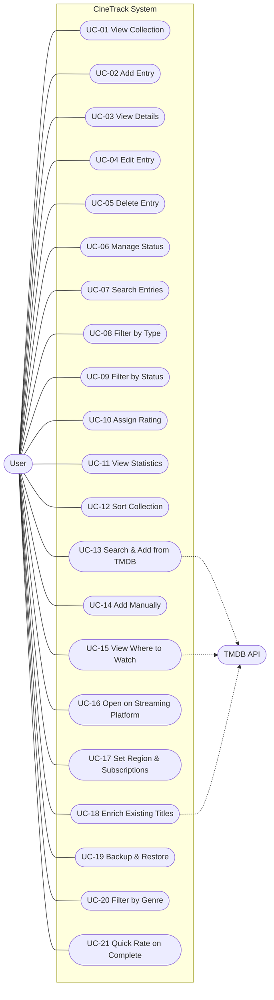

# CineTrack — Use Case Specification

**Document ID:** CT-UC-001\
**Version:** 2.0\
**Status:** Final\
**Project:** CineTrack\
**Last updated:** 2026-11-28

## Revision History

| Version | Date | Summary | Reason |
| --- | --- | --- | --- |
| 2.0 | 2026-11-28 | Added UC-13…UC-21, external actor TMDB, offline alternatives, rating/enrichment/backup/settings flows | Lecturer consultation + UX fixes |
| 1.0 | 2026-11-25 | Initial UC-01…UC-12 | Project setup |

---

## 1. Actors

| Actor | Type | Description |
| --- | --- | --- |
| User | Primary | Manages the personal collection and settings |
| TMDB API | External system | Provides search results, metadata, images, and watch-provider data (JustWatch) |

## 2. Use Case Diagram

## 3. Use Case List

| ID | Use Case | Related FR | Description |
| --- | --- | --- | --- |
| UC-01 | View Collection | FR-01, FR-12, FR-19 | View saved titles and Home sections |
| UC-02 | Add Entry | FR-02, FR-16 | General add flow (online or manual) |
| UC-03 | View Details | FR-06, FR-17 | Hero, synopsis, where to watch |
| UC-04 | Edit Entry | FR-03, FR-15 | Modify metadata or find info automatically |
| UC-05 | Delete Entry | FR-04 | Delete with confirmation and Undo |
| UC-06 | Manage Status | FR-05 | Change viewing status |
| UC-07 | Search Entries | FR-07 | Search collection by title/genre |
| UC-08 | Filter by Type | FR-08 | Movie/Series filter |
| UC-09 | Filter by Status | FR-09 | Status filter |
| UC-10 | Assign Rating | FR-10 | Personal 1–5 rating |
| UC-11 | View Statistics | FR-11 | Collection statistics |
| UC-12 | Sort Collection | FR-13 | Recent/Title/Rating/Year |
| UC-13 | Search & Add from TMDB | FR-14, FR-15, FR-16 | Search-first add with auto metadata |
| UC-14 | Add Manually | FR-16, FR-02 | Offline/manual fallback and custom poster |
| UC-15 | View Where to Watch | FR-17 | Providers per region + cache refresh |
| UC-16 | Open on Streaming Platform | FR-18 | Template/fallback deep link |
| UC-17 | Set Region & Subscriptions | FR-22 | Settings preferences |
| UC-18 | Enrich Existing Titles | FR-23 | Auto-match + Needs review |
| UC-19 | Backup & Restore | FR-24 | JSON export/import v2/v1 |
| UC-20 | Filter by Genre | FR-21 | Genre filter in the sheet |
| UC-21 | Quick Rate on Complete | FR-20 | Skippable rating sheet |

## 4. Detailed Use Case Descriptions

### UC-01 — View Collection

| Attribute | Description |
| --- | --- |
| Primary Actor | User |
| Preconditions | Application opened |
| Trigger | User opens Home or Watchlist |
| Main Flow | 1. Load `media` from SQLite. 2. Compute statistics. 3. Show tappable status summary, Continue Watching, Up Next, Recently Completed. 4. Cards render posters/providers from cache. |
| Alternative Flow | If empty, show CTA “Find your first movie”. If loading, show spinner. If a card has no poster, show a genre-themed placeholder. |
| Postconditions | Collection displayed; no data modified. |

### UC-02 — Add Entry

| Attribute | Description |
| --- | --- |
| Primary Actor | User |
| Preconditions | Application running |
| Trigger | User taps + |
| Main Flow | 1. Open Add Media with focused search. 2. User searches TMDB or chooses manual. 3. Confirm status/rating. 4. Validate title. 5. Persist to SQLite. 6. Refresh collection and show snackbar. |
| Alternative Flow | Offline/invalid token → informational banner + manual form. Duplicate → “Already in your collection.” Detail fetch fails → save basic metadata. |
| Postconditions | New row stored (or no change on failure). |

### UC-03 — View Details

| Attribute | Description |
| --- | --- |
| Primary Actor | User |
| Preconditions | Entry exists |
| Trigger | User taps a card |
| Main Flow | 1. Load entry from context. 2. Show hero, poster, metadata, rating, status. 3. Show where to watch from cache. 4. If cache stale/absent and online, refresh in background. |
| Alternative Flow | Entry deleted → “Not found”. No provider cache → neutral message. Offline with cache → show cache. |
| Postconditions | Details displayed; provider cache may update. |

### UC-04 — Edit Entry

| Attribute | Description |
| --- | --- |
| Primary Actor | User |
| Preconditions | Entry exists |
| Trigger | User selects Edit (details or card menu) |
| Main Flow | 1. Load existing values. 2. User edits fields. 3. Optional: “Find poster & info automatically” opens TMDB search. 4. Selecting a result fills missing metadata. 5. Save. 6. Validate and update SQLite. |
| Alternative Flow | Existing genre/year/description → ask Keep/Replace. Invalid title → inline error. Network failure → keep current data. |
| Postconditions | Entry updated; old local poster deleted if replaced. |

### UC-05 — Delete Entry

| Attribute | Description |
| --- | --- |
| Primary Actor | User |
| Preconditions | Entry exists |
| Trigger | Delete from details or card menu |
| Main Flow | 1. Show confirmation. 2. Confirm. 3. Delete row. 4. Show snackbar “Deleted … — Undo”. 5. After 6 s, delete local poster file. |
| Alternative Flow | Cancel → no change. Undo within 5 s → re-insert row and cancel file deletion. |
| Postconditions | Entry removed or restored. |

### UC-06 — Manage Status

| Attribute | Description |
| --- | --- |
| Primary Actor | User |
| Preconditions | Entry exists |
| Trigger | User selects a status |
| Main Flow | 1. Validate status. 2. Persist. 3. Update UI. 4. If Completed, offer quick rating (UC-21). |
| Alternative Flow | Same status → no-op. Save fail → alert. |
| Postconditions | Status updated. |

### UC-07 / UC-08 / UC-09 — Search, Type Filter, Status Filter

| Attribute | Description |
| --- | --- |
| Primary Actor | User |
| Preconditions | Watchlist available |
| Trigger | User types or opens Filter & Sort |
| Main Flow | 1. Combine query/type/status/genre. 2. Filter in memory. 3. Show results. 4. Active filters appear as removable chips. |
| Alternative Flow | No matches → “No results”. Empty collection → CTA. |
| Postconditions | Filtered view only; data unchanged. |

### UC-10 — Assign Rating

| Attribute | Description |
| --- | --- |
| Primary Actor | User |
| Preconditions | Entry exists |
| Trigger | Tap rating in Details or rating sheet |
| Main Flow | 1. Show stars/value. 2. Choose 1–5 (0.5 step). 3. Persist. 4. Update UI/statistics. |
| Alternative Flow | Clear rating → null. Invalid → rejected. |
| Postconditions | Rating stored. |

### UC-11 — View Statistics

| Attribute | Description |
| --- | --- |
| Primary Actor | User |
| Preconditions | Collection loaded |
| Trigger | Open Statistics tab |
| Main Flow | Compute total, average rating, by status, by type; display bars. |
| Alternative Flow | Empty collection → zeros. |
| Postconditions | Statistics displayed. |

### UC-12 — Sort Collection

| Attribute | Description |
| --- | --- |
| Primary Actor | User |
| Preconditions | Watchlist available |
| Trigger | Select sort in Filter & Sort |
| Main Flow | Apply Recent/Title A–Z/Rating/Year; null values last; display. |
| Alternative Flow | Empty list → no-op. |
| Postconditions | Sorted view. |

### UC-13 — Search & Add from TMDB

| Attribute | Description |
| --- | --- |
| Primary Actor | User |
| Supporting Actor | TMDB API |
| Preconditions | Add screen open; optionally internet + valid token |
| Trigger | User types ≥ 2 characters |
| Main Flow | 1. Debounce 400 ms. 2. `search/multi` returns movies/TV (people removed). 3. Show poster/title/year/type; mark existing `(tmdb_id,type)`. 4. User taps a result. 5. Fetch details + watch providers. 6. Show confirmation sheet with poster, year, genres, synopsis. 7. User chooses status (default To Watch) and optional rating if Completed. 8. Add to Collection. 9. Persist mapped data and refresh. |
| Alternative Flow | Token missing/invalid → banner + manual link. Offline/timeout → banner + manual link. Duplicate → disabled badge/“Already in your collection.” Detail fetch fails → allow saving basic metadata. User cancels sheet → nothing saved. |
| Postconditions | Row stored with TMDB id, poster/backdrop, genres, year, synopsis, providers, region, timestamp. |

### UC-14 — Add Manually

| Attribute | Description |
| --- | --- |
| Primary Actor | User |
| Preconditions | Add screen open |
| Trigger | “Can’t find it? Add manually” |
| Main Flow | 1. Show form. 2. Only Title is required. 3. Type defaults Movie; status defaults To Watch. 4. Optional section: genre, year, rating, description, poster. 5. Choose poster from gallery (copied to documents). 6. Save. |
| Alternative Flow | Invalid title → error. User cancels poster picker → no change. Offline → same flow works. |
| Postconditions | Row stored; optional poster path stored. |

### UC-15 — View Where to Watch

| Attribute | Description |
| --- | --- |
| Primary Actor | User |
| Supporting Actor | TMDB API |
| Preconditions | Entry exists; providers may be cached |
| Trigger | Open Details |
| Main Flow | 1. Read `providers_json` for the current region. 2. Group Stream / Free & Ads / Rent / Buy. 3. Show logos/names/buttons and “Updated … ago”. 4. If cache > 7 days or region changed and online, refresh in background. |
| Alternative Flow | Offline with cache → show cache. No cache → “Streaming info unavailable offline.” No providers → no streaming area/neutral message. Refresh fails → keep cache. |
| Postconditions | Provider data displayed; cache may update. |

### UC-16 — Open on Streaming Platform

| Attribute | Description |
| --- | --- |
| Primary Actor | User |
| Preconditions | Provider/button displayed |
| Trigger | Tap “Open on …” or a provider logo |
| Main Flow | 1. Build link: verified template with encoded title, else TMDB/JustWatch link. 2. `Linking.openURL`. 3. OS opens app/browser. |
| Alternative Flow | No link → alert “Cannot open the link”. URL fails → same alert; no crash. |
| Postconditions | External page/app opened or safe failure. |

### UC-17 — Set Region & Subscriptions

| Attribute | Description |
| --- | --- |
| Primary Actor | User |
| Preconditions | Settings open |
| Trigger | Tap Region or My streaming subscriptions |
| Main Flow | 1. Region list/custom ISO input. 2. Save to `app_settings`. 3. Refresh up to 20 provider caches. 4. Save subscriptions as provider-id array. 5. Cards prioritize selected services. |
| Alternative Flow | Invalid code → error. Offline → region saved; refresh skipped; subscriptions fallback list. |
| Postconditions | Settings persisted; cards/details reflect new preferences. |

### UC-18 — Enrich Existing Titles

| Attribute | Description |
| --- | --- |
| Primary Actor | User |
| Supporting Actor | TMDB API |
| Preconditions | Items without `tmdb_id` exist; online + token |
| Trigger | Settings → “Complete my existing titles automatically” |
| Main Flow | 1. Process items sequentially (~250 ms). 2. Search by title. 3. Exact title/type/year → fetch details/providers, fill missing fields, set TMDB id/poster. 4. Show progress `current/total`. 5. Non-exact → Needs review with top 3 candidates. 6. User picks a candidate; optionally keep/replace existing details. |
| Alternative Flow | Cancel → stop after current request, keep applied results. Offline → errors counted, process stops gracefully. Item already has TMDB id → skipped. |
| Postconditions | Metadata improved; user fields preserved unless consent. |

### UC-19 — Backup & Restore

| Attribute | Description |
| --- | --- |
| Primary Actor | User |
| Preconditions | Backup screen open |
| Trigger | Export or Choose Backup File |
| Main Flow | 1. Export writes JSON v2 to cache and opens share sheet. 2. Import picks a JSON file. 3. Validate JSON/items. 4. Deduplicate (`tmdb_id|type` or `title|type|year`). 5. Insert valid rows in a transaction. 6. Report imported/duplicates/invalid. |
| Alternative Flow | Invalid JSON → alert. No sharing available → alert. Backup v1 → accepted. |
| Postconditions | File shared or data imported; existing rows kept. |

### UC-20 — Filter by Genre

| Attribute | Description |
| --- | --- |
| Primary Actor | User |
| Preconditions | Watchlist available |
| Trigger | Open Filter & Sort → choose Genre → Apply |
| Main Flow | 1. Match any genre token (case-insensitive). 2. Combine with query/type/status/sort. 3. Show chip. |
| Alternative Flow | No matches → “No results”. Remove chip → filter resets to All. |
| Postconditions | Filtered view. |

### UC-21 — Quick Rate on Complete

| Attribute | Description |
| --- | --- |
| Primary Actor | User |
| Preconditions | Entry exists |
| Trigger | Status changed to Completed |
| Main Flow | 1. Persist Completed. 2. Show rating sheet. 3. User selects 1–5. 4. Save rating. |
| Alternative Flow | Skip → status stays Completed, rating unchanged. Save fails → alert; status remains. |
| Postconditions | Completed status (and optionally rating) stored. |

---

**End of Document**

Document ID: CT-UC-001\
Version: 2.0\
Project: CineTrack
