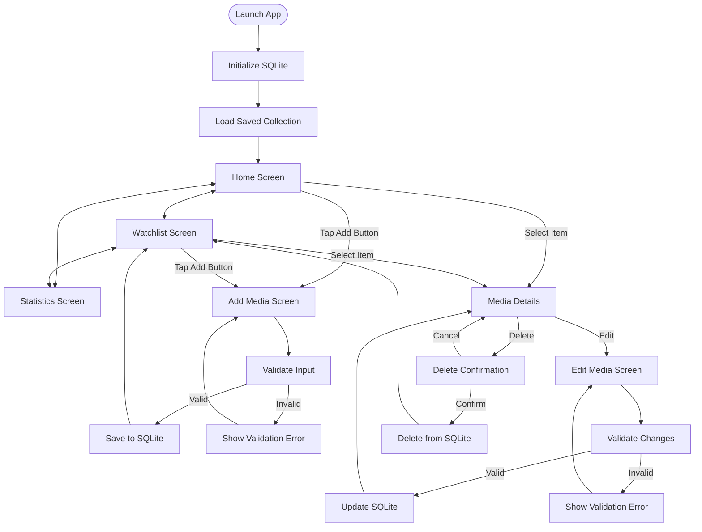
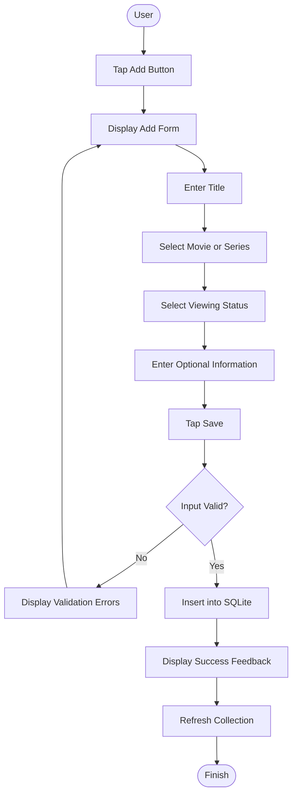
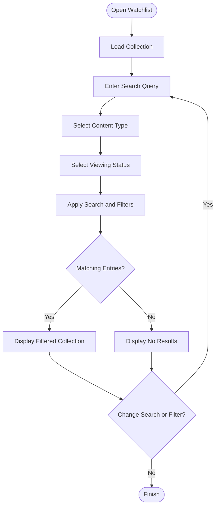

# CineTrack — User Flow Diagram

**Phase:** 3 — System Design\
**Document:** 05-user-flow\
**Project:** CineTrack\
**Status:** Draft

User Flow menggambarkan perjalanan pengguna dari satu halaman ke halaman lainnya. Dokumen ini mengacu pada requirement di `02-srs.md` dan use case di `03-use-case.md`.

## 1. Screen Inventory

Berdasarkan requirement Phase 2, CineTrack memiliki lima area utama:

| Screen        | Fungsi                            | Related FR              |
| ------------- | --------------------------------- | ----------------------- |
| Home          | Menampilkan koleksi dan ringkasan | FR-01, FR-11            |
| Add Media     | Menambahkan film atau series      | FR-02                   |
| Media Details | Melihat informasi tontonan        | FR-06, FR-04, FR-05     |
| Edit Media    | Mengubah informasi tontonan       | FR-03, FR-10            |
| Statistics    | Melihat statistik koleksi         | FR-11                   |

Selain itu, **Watchlist** menjadi halaman koleksi lengkap yang menyediakan search, filter, dan sorting (FR-07, FR-08, FR-09, FR-12).

Untuk navigasi utama (bottom navigation), digunakan tiga bagian:

- Home
- Watchlist
- Statistics

Add Media dapat diakses melalui tombol tambah pada halaman Home atau Watchlist. Media Details diakses dengan memilih sebuah item dari Home atau Watchlist.

## 2. Main Navigation Flow

## 3. Add Media Flow

## 4. Search & Filter Flow

**Design decision:** Search, content-type filter, dan status filter harus bisa digunakan bersamaan. Contohnya, pengguna dapat mencari "Batman", memilih Movie, lalu memilih Completed. Sesuai BR-08, search dan filter tidak boleh mengubah data di database.
