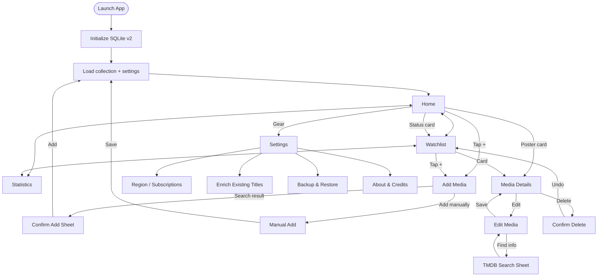
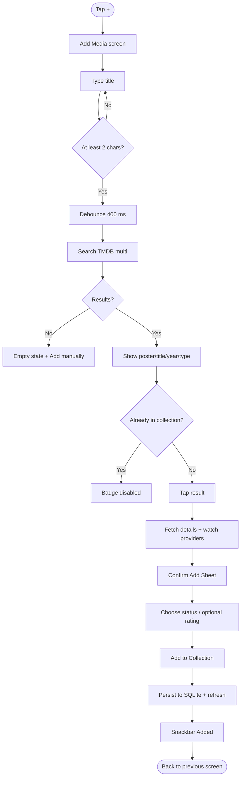
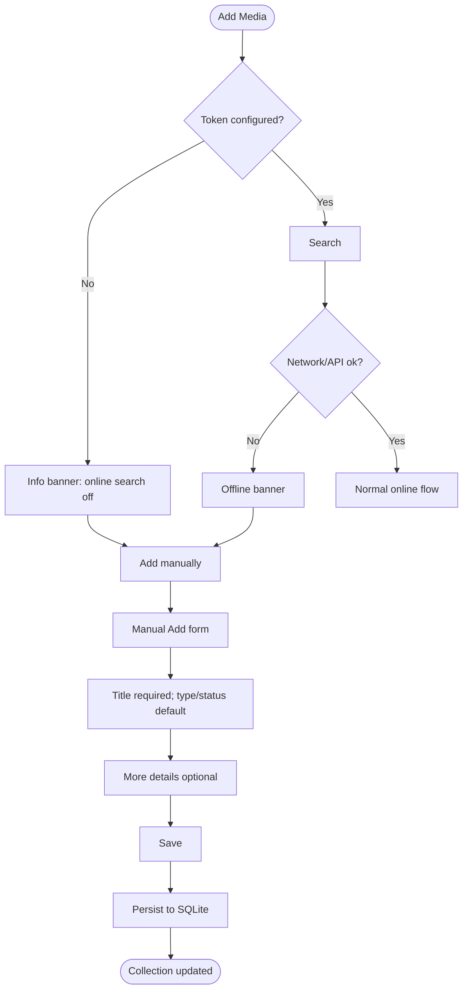
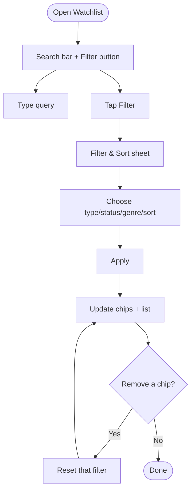
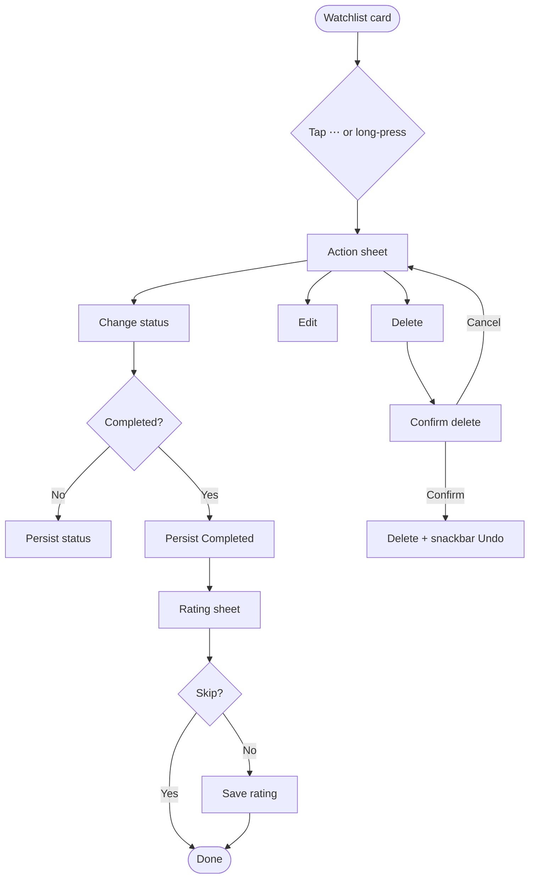
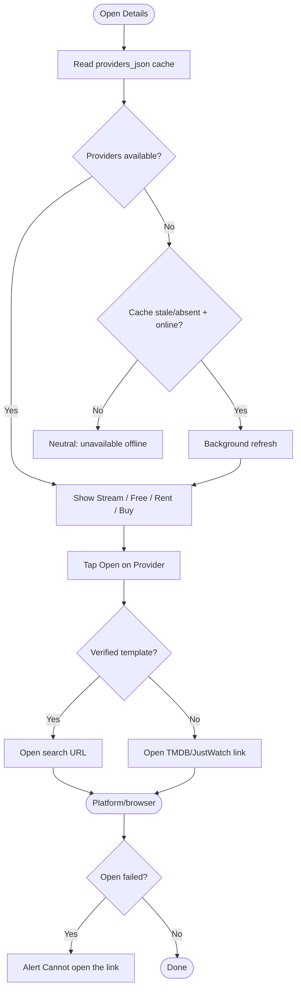
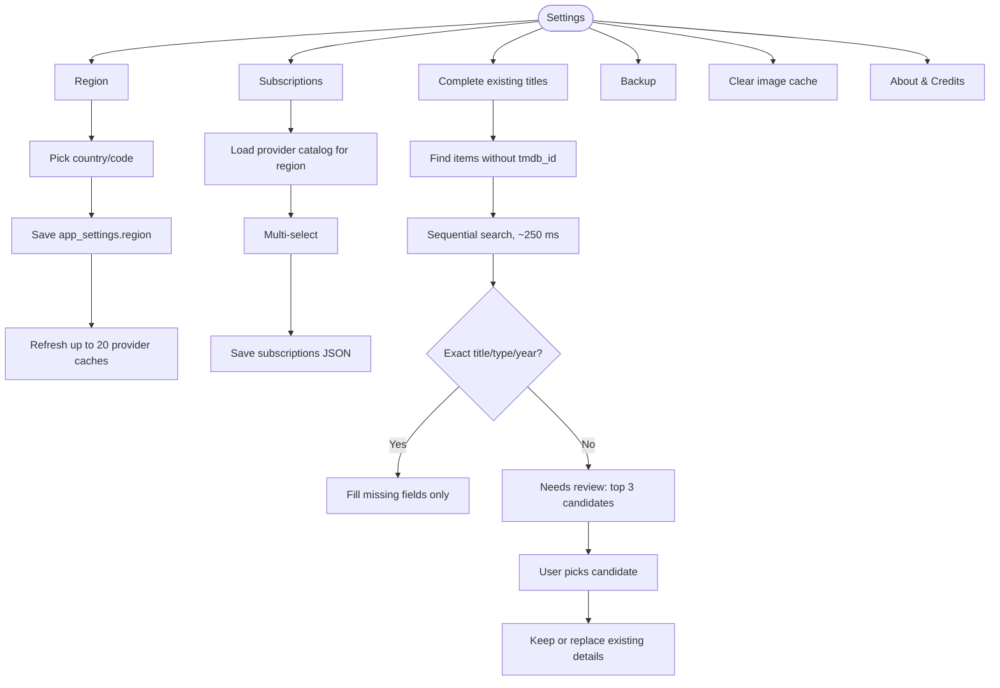

# CineTrack — User Flow Diagram

**Document ID:** CT-UF-001\
**Version:** 2.0\
**Status:** Final\
**Phase:** 3 — System Design\
**Project:** CineTrack\
**Last updated:** 2026-11-28

## Revision History

| Version | Date | Summary | Reason |
| --- | --- | --- | --- |
| 2.0 | 2026-11-28 | Search-first add, offline/manual fallback, filter sheet, where-to-watch, settings, enrichment, rating-on-complete | Lecturer consultation + UX fixes |
| 1.0 | 2026-11-25 | Initial five-screen flow | Project setup |

---

## 1. Screen Inventory

| Screen | Function | Related FR |
| --- | --- | --- |
| Home | Status summary, Continue Watching, Up Next, Recently Completed | FR-01, FR-11, FR-19 |
| Watchlist | Full collection, search, filter sheet, chips, card actions | FR-01, FR-04, FR-07…FR-09, FR-13, FR-20, FR-21 |
| Add Media | Search-first TMDB add + manual link | FR-02, FR-14, FR-15, FR-16 |
| Manual Add | Offline/manual form (title only required) | FR-02, FR-16 |
| Media Details | Hero, rating, status, where to watch, synopsis | FR-06, FR-17, FR-18, FR-20 |
| Edit Media | Edit form + “Find poster & info automatically” | FR-03, FR-15, FR-16 |
| Statistics | Collection statistics | FR-11 |
| Settings | Region, subscriptions, enrichment, cache, about | FR-22, FR-23 |
| Backup & Restore | Export/import JSON v2, import v1 | FR-24 |

Bottom tabs: **Home**, **Watchlist**, **Statistics**. Add/Manual/Details/Edit/Backup/Settings are stack screens.

## 2. Main Navigation Flow

## 3. Search-First Add Flow (Online)

## 4. Add Flow — Offline / Invalid Token

## 5. Watchlist Filter & Sort Flow

## 6. Card Action & Rating Flow

## 7. Details → Where to Watch → Open Platform

## 8. Settings & Enrichment Flow

## 9. Design Notes

- Search/filter/sort are computed in memory from the same collection used by Home and Statistics, keeping numbers consistent.
- Search and filtering never modify SQLite.
- The online add flow always exposes a manual escape hatch.
- Destructive actions are confirmed; delete is reversible for 5 seconds.
- Provider cache is region-specific and stale after 7 days.
- UI text remains English; documentation stays Indonesian where it was Indonesian.
