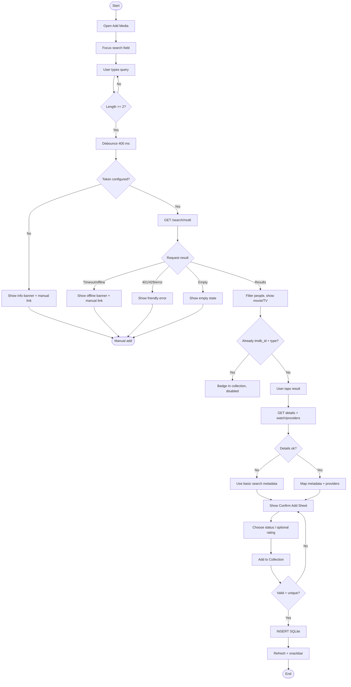
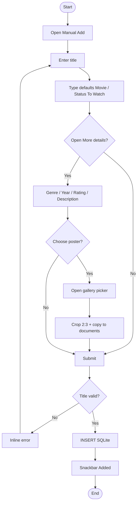
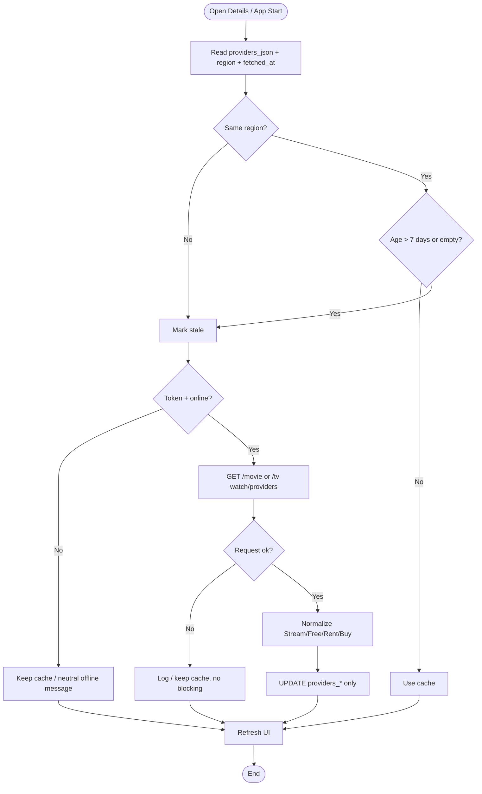
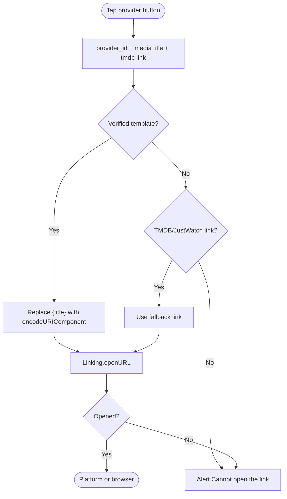
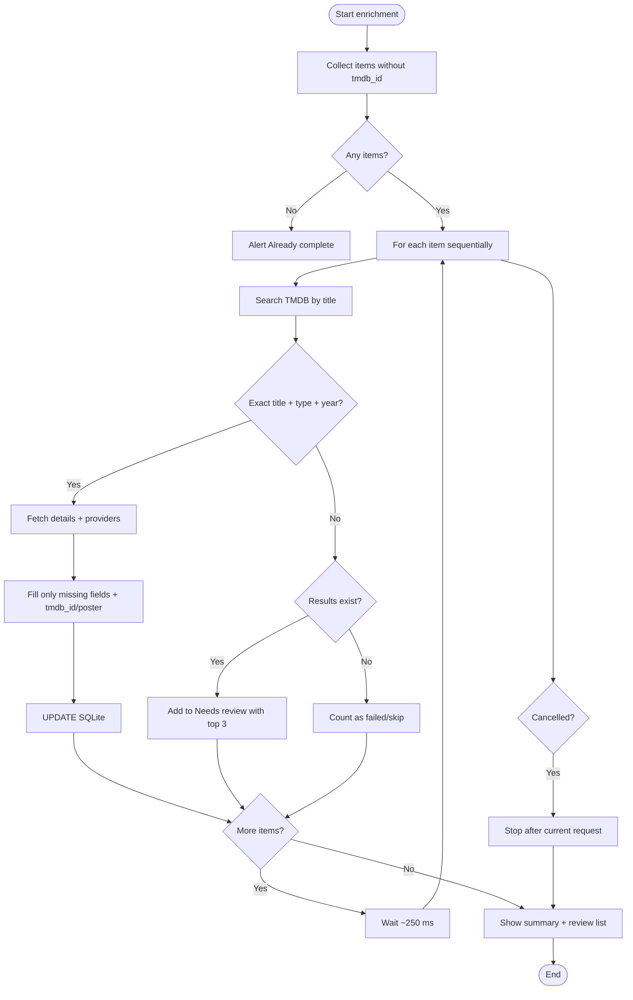
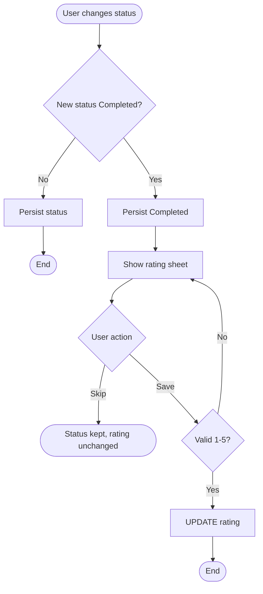

# CineTrack — Activity Diagrams

**Document ID:** CT-ACT-001\
**Version:** 2.0\
**Status:** Final\
**Phase:** 3 — System Design\
**Project:** CineTrack\
**Last updated:** 2026-11-28

## Revision History

| Version | Date | Summary | Reason |
| --- | --- | --- | --- |
| 2.0 | 2026-11-28 | Added search/add TMDB, provider refresh/TTL, open-on-platform fallback, enrichment, rating-on-complete; revised edit/delete | Lecturer consultation + UX fixes |
| 1.0 | 2026-11-25 | Initial add/edit/delete/search activities | Project setup |

---

Activity diagrams describe branches, decisions, and system actions. Provider/network failures always end in a safe, explainable state.

## 1. Search & Add from TMDB

Related: FR-02, FR-14, FR-15, FR-16, FR-21, UC-13.

## 2. Manual Add (Offline Fallback)

Related: FR-02, FR-16, UC-14.

## 3. Refresh Provider Cache (TTL)

Related: FR-17, UC-15, NFR-09.

## 4. Open on Streaming Platform

Related: FR-18, UC-16.

## 5. Enrich Existing Titles

Related: FR-23, UC-18.

## 6. Quick Rate on Complete

Related: FR-20, UC-21.

