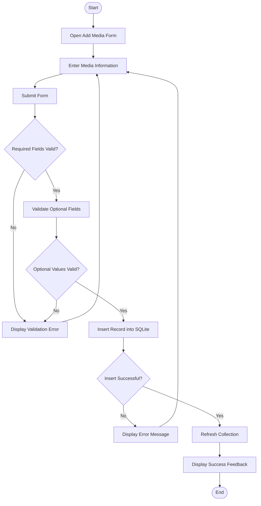
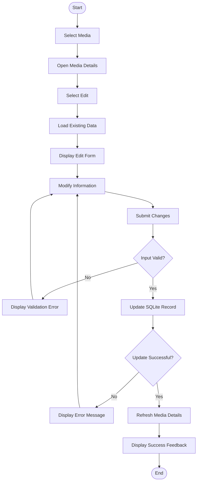
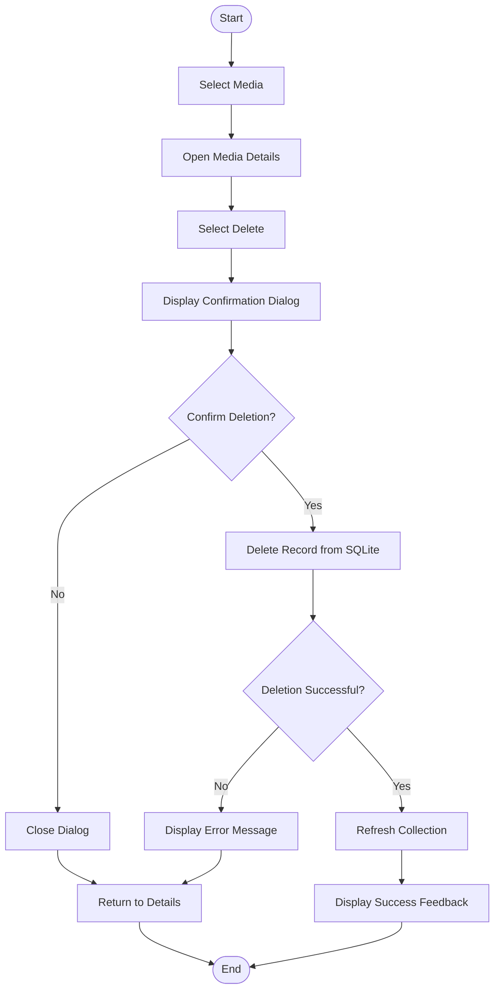
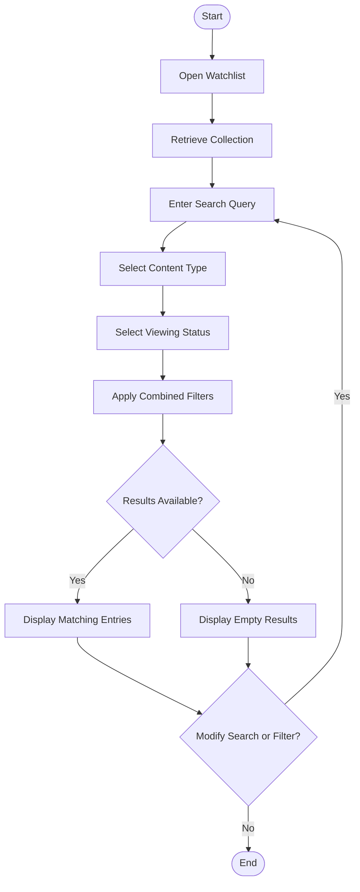

# CineTrack — Activity Diagrams

**Phase:** 3 — System Design\
**Document:** 07-activity-diagrams\
**Project:** CineTrack\
**Status:** Draft

Activity Diagram menggambarkan alur aktivitas secara lebih detail, termasuk kondisi, percabangan, dan proses yang dilakukan sistem. Diagram dibuat untuk empat proses utama.

## 1. Add Media Activity

Related: FR-02, UC-02.

## 2. Edit Media Activity

Related: FR-03, UC-04.

## 3. Delete Media Activity

Related: FR-04, UC-05, BR-07.

## 4. Search & Filter Activity

Related: FR-07, FR-08, FR-09, UC-07, UC-08, UC-09, BR-08.

