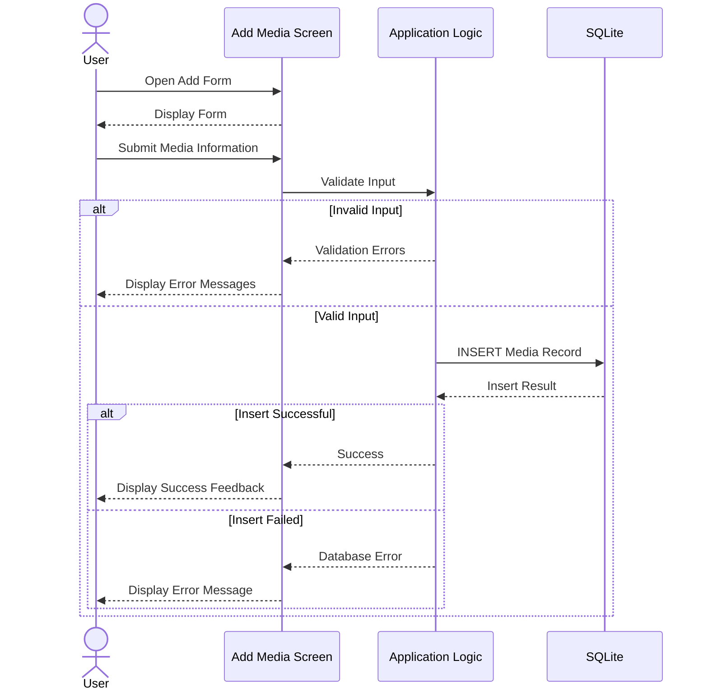
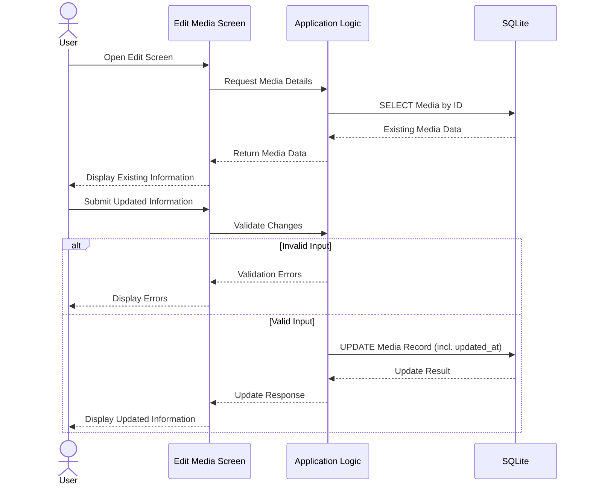
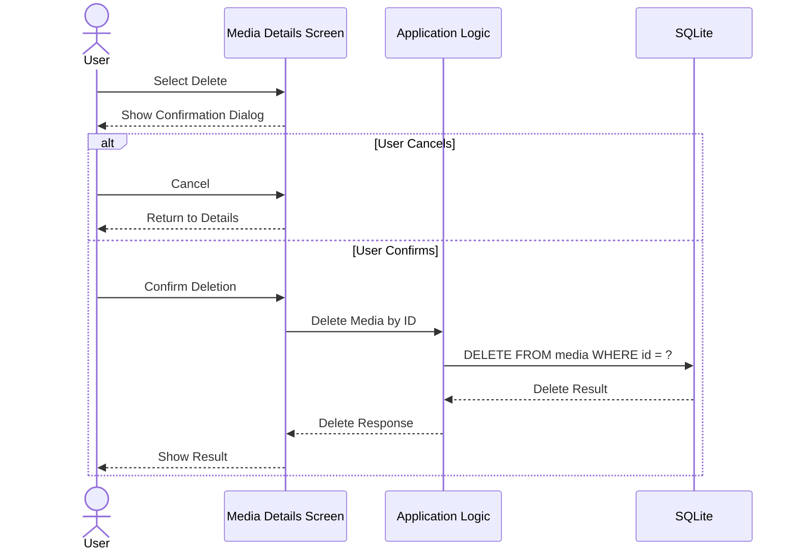
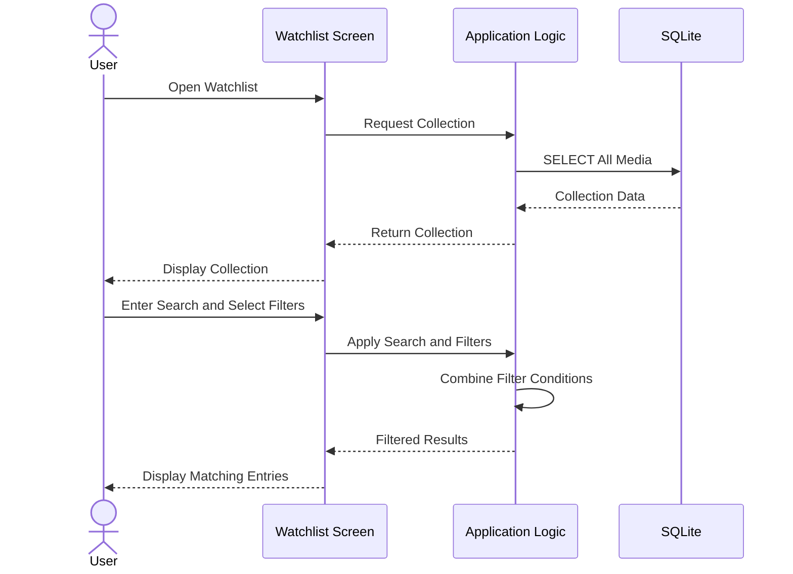

# CineTrack — Sequence Diagrams

**Phase:** 3 — System Design\
**Document:** 08-sequence-diagrams\
**Project:** CineTrack\
**Status:** Draft

Sequence Diagram menggambarkan komunikasi antar komponen sistem berdasarkan urutan waktu.

## Participants

| Participant | Responsibility                                                       |
| ----------- | -------------------------------------------------------------------- |
| User        | Melakukan interaksi                                                  |
| UI          | Menampilkan halaman dan menerima input                               |
| Logic       | Memproses aturan aplikasi (`mediaService`, `validationService`, `mediaRepository`) |
| SQLite      | Menyimpan dan mengambil data                                         |

## 1. Add Media Sequence

## 2. Edit Media Sequence

## 3. Delete Media Sequence

## 4. Search & Filter Sequence

**Catatan desain:** Search dan filter dapat diproses terhadap data yang sudah dimuat dari SQLite untuk koleksi berukuran kecil. Jika koleksi berkembang besar, pemrosesan dapat dipindahkan ke query SQLite.
