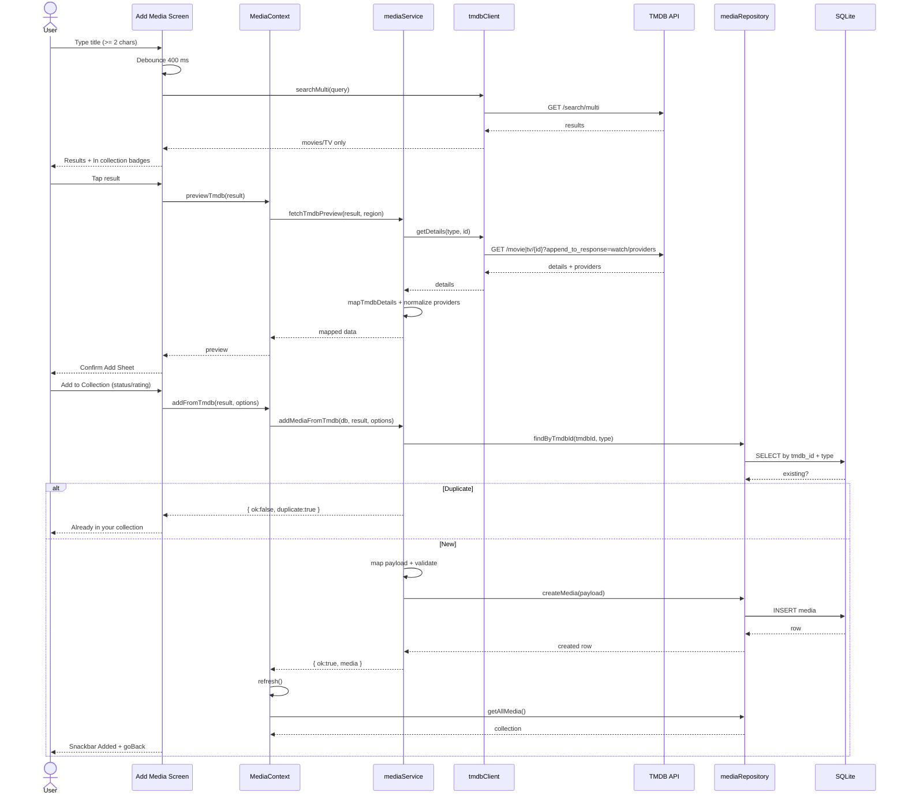
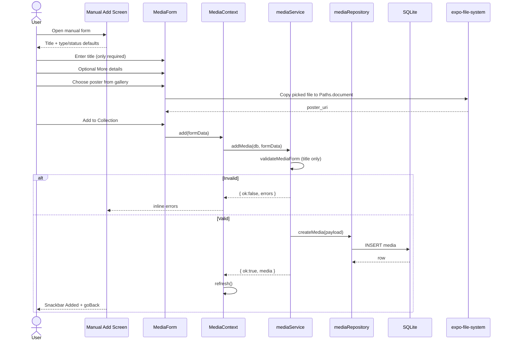
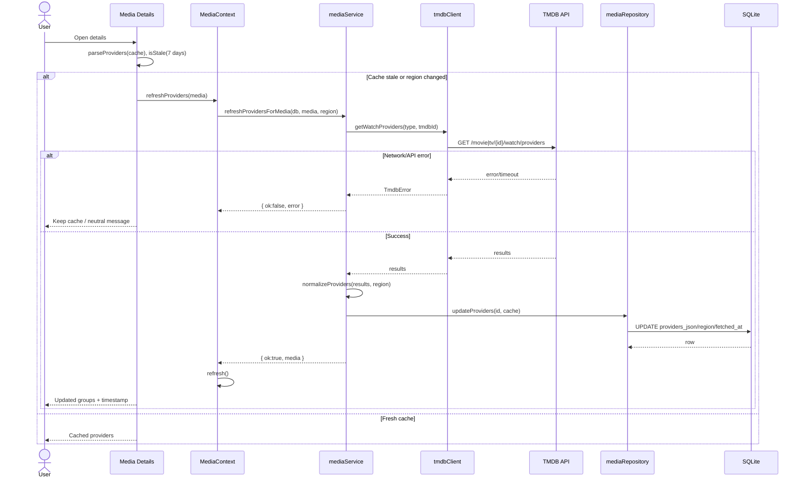
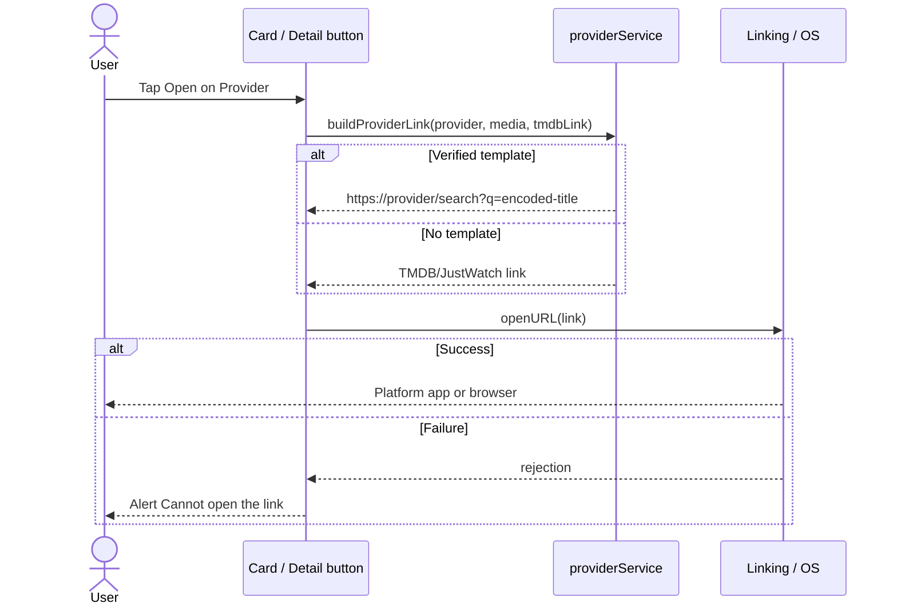
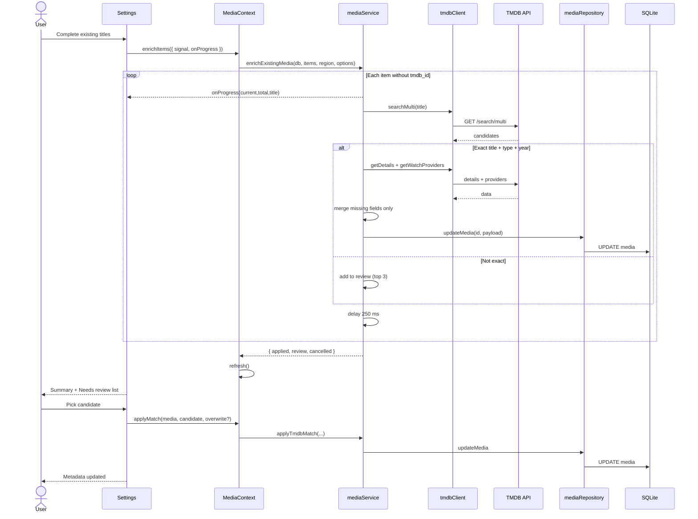
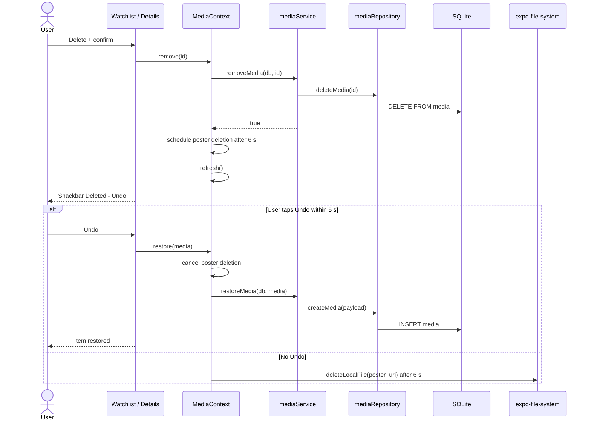

# CineTrack — Sequence Diagrams

**Document ID:** CT-SEQ-001\
**Version:** 2.0\
**Status:** Final\
**Phase:** 3 — System Design\
**Project:** CineTrack\
**Last updated:** 2026-11-28

## Revision History

| Version | Date | Summary | Reason |
| --- | --- | --- | --- |
| 2.0 | 2026-11-28 | Added TMDB add, provider refresh, open platform, offline manual, enrichment sequences | Lecturer consultation + UX fixes |
| 1.0 | 2026-11-25 | Initial add/edit/delete/search sequences | Project setup |

---

## Participants

| Participant | Responsibility |
| --- | --- |
| User | Interacts with the app |
| Screen | UI screen/sheet |
| Context | `MediaContext` state and async actions |
| Service | `mediaService`, `tmdbMapper`, `providerService`, `validationService` |
| TMDBClient | `tmdbClient` request wrapper (timeout/retry/errors) |
| TMDB | External TMDB API (metadata + JustWatch providers) |
| Repo | `mediaRepository` / `settingsRepository` |
| SQLite | Local database v2 |
| Linking | OS/browser/platform app |

## 1. Add via TMDB

Related: FR-02, FR-14, FR-15, UC-13.

## 2. Add Manually / Offline

Related: FR-02, FR-16, UC-14.

## 3. Refresh Providers (Cache/TTL)

Related: FR-17, UC-15.

## 4. Open on Streaming Platform

Related: FR-18, UC-16.

## 5. Enrich Existing Titles

Related: FR-23, UC-18.

## 6. Delete with Undo

Related: FR-04, UC-05.

**Design note:** search/filter/sort run in memory from the loaded collection. This keeps Home, Watchlist, and Statistics consistent. SQL is only used in repositories.
