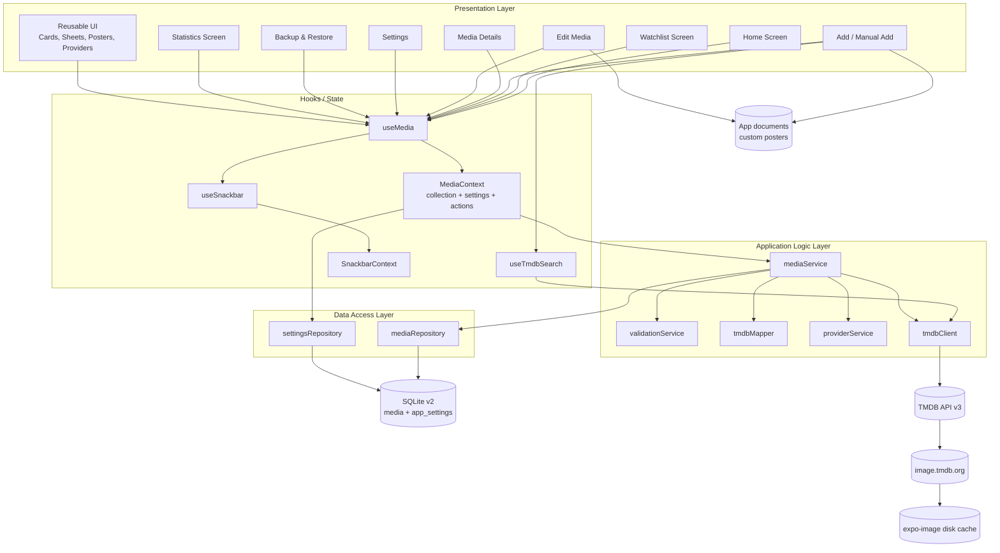
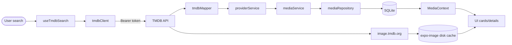
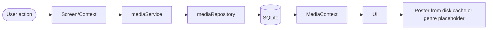

# CineTrack — System Architecture

**Document ID:** CT-ARCH-001\
**Version:** 2.0\
**Status:** Final\
**Phase:** 3 — System Design\
**Project:** CineTrack\
**Last updated:** 2026-11-28

## Revision History

| Version | Date | Summary | Reason |
| --- | --- | --- | --- |
| 2.0 | 2026-11-28 | Added TMDB client/mapper/provider service, settings repository, image cache, online/offline data flow, external systems | Lecturer consultation + UX fixes |
| 1.0 | 2026-11-25 | Initial layered architecture | Project setup |

---

CineTrack uses a **Layered Architecture** with a strict dependency direction. The UI never talks to SQLite or the network directly.

## 1. Architecture Diagram

## 2. Layer Responsibilities

| Layer | Responsibilities |
| --- | --- |
| Presentation | Screens, cards, sheets, forms, navigation, accessibility |
| Hooks / State | Collection state, settings, snackbar, debounced search, card model |
| Application Logic | Validation, TMDB mapping, provider normalization, filtering/sorting, backup, orchestration |
| Data Access | SQL queries for `media` and `app_settings`; migrations |
| Local storage | SQLite v2; image disk cache; custom poster files |
| External systems | TMDB API v3; JustWatch provider data via TMDB; platform apps via Linking |

**Why this layering?**

A screen should not know whether data came from SQLite, TMDB, or a cache. Changing an endpoint or column only affects the service/repository. It also makes pure logic unit-testable without a device.

## 3. Online vs Offline Data Flow

### 3.1 Online add/enrichment

### 3.2 Offline core

No online call is required for CRUD, status, rating, search/filter/sort, statistics, or backup.

## 4. TMDB Integration Boundaries

- `tmdbClient` is the **only** module that performs network requests.
- `tmdbMapper` is pure (TMDB result → CineTrack form/payload).
- `providerService` is pure (normalization, primary provider, links, TTL).
- `mediaService` orchestrates: duplicate check, detail fetch, provider fetch, validation, persistence.
- API errors are mapped to friendly `TmdbError` codes (`AUTH`, `RATE_LIMIT`, `OFFLINE`, `SERVER`, `ABORTED`).
- The token comes from `EXPO_PUBLIC_TMDB_TOKEN`; absence disables online features.

## 5. State Strategy

| State | Location | Notes |
| --- | --- | --- |
| Collection | `MediaContext` | Loaded from SQLite; refreshed after mutations |
| Settings | `MediaContext` + `app_settings` | `region`, `subscriptions` |
| Snackbar | `SnackbarContext` | One message at a time; optional action |
| TMDB search | `useTmdbSearch` | Debounced, cancellable, idle/loading/success/empty/error/offline |
| Filters/sort | `WatchlistScreen` | In-memory, not persisted (v2) |
| Provider cache | `media.providers_*` | SQLite; not in React state separately |
| Custom poster | `media.poster_uri` + documents | Local file path |
| Image cache | `expo-image` | Disk-based |

## 6. Architecture Decisions Summary

| Area | Decision |
| --- | --- |
| Framework | React Native 0.88 + Expo SDK 58 |
| Language | JavaScript |
| Navigation | React Navigation 7 (stack + tabs) |
| Database | SQLite v2 via expo-sqlite |
| Architecture | Layered |
| Entities | `media`, `app_settings` |
| Main tabs | Home, Watchlist, Statistics |
| UI theme | Dark |
| External API | TMDB API v3 (optional) |
| Provider data | TMDB + JustWatch |
| Images | expo-image disk cache |
| Offline detection | Request failure/timeout (no NetInfo) |
| Bottom sheets | React Native `Modal` |
| Token storage | `EXPO_PUBLIC_TMDB_TOKEN` (client; accepted risk) |
| Authentication | Not required |

## 7. Implementation Notes

1. Native packages must be installed with `npx expo install` to match SDK 58.
2. SQLite initialization/migration runs before screens use data.
3. Provider refresh must not bump `updated_at` (it is cache, not user activity).
4. Background refresh is limited to 20 eligible items per session.
5. TMDB failures must never blank a screen; fall back to cache or manual flows.
6. A backend proxy is the production alternative for token secrecy.

**End of Document**

Document ID: CT-ARCH-001\
Version: 2.0\
Project: CineTrack
