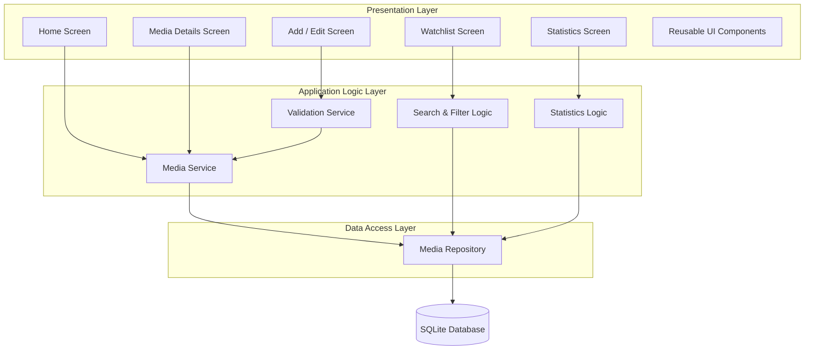
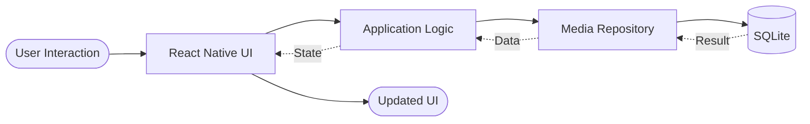

# CineTrack — System Architecture

**Phase:** 3 — System Design\
**Document:** 09-system-architecture\
**Project:** CineTrack\
**Status:** Draft

CineTrack menggunakan pendekatan **Layered Architecture** dengan pemisahan tanggung jawab.

## 1. Architecture Diagram

## 2. Layer Responsibilities

| Layer             | Responsibilities                                      |
| ----------------- | ----------------------------------------------------- |
| Presentation      | Screens, forms, cards, navigation                     |
| Application Logic | CRUD rules, validation, search, filtering, statistics |
| Data Access       | Database queries and data persistence                 |
| Database          | Local SQLite storage                                  |

**Kenapa menggunakan arsitektur ini?**

Kita tidak ingin seluruh logika database ditulis langsung di dalam komponen UI. Dengan memisahkan layer, perubahan database tidak harus membuat seluruh halaman ditulis ulang.

## 3. Data Flow

## 4. Architecture Decisions Summary

| Area             | Decision                    |
| ---------------- | --------------------------- |
| Framework        | React Native                |
| Runtime          | Expo Go                     |
| Language         | JavaScript                  |
| Navigation       | React Navigation            |
| Database         | SQLite                      |
| Database Library | expo-sqlite                 |
| Architecture     | Layered Architecture        |
| Database Entity  | Single `media` table        |
| Main Navigation  | Home, Watchlist, Statistics |
| UI Theme         | Dark                        |
| External API     | Not required                |
| Authentication   | Not required                |

## 5. Implementation Notes

Tiga hal yang perlu diingat ketika implementasi nanti:

1. Expo Go memiliki batas kompatibilitas library. Dependency harus dipasang menggunakan `npx expo install` agar versinya sesuai dengan Expo SDK proyek.
2. SQLite perlu diinisialisasi sebelum halaman yang membutuhkan data dijalankan.
3. Statistik, search, dan filter harus mengambil data dari sumber yang sama agar hasilnya konsisten.
