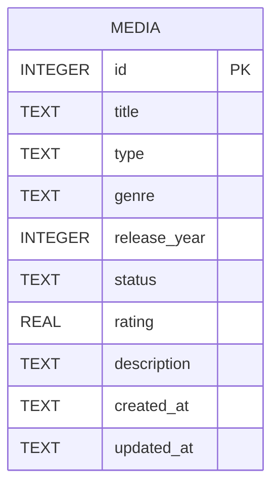

# CineTrack — Database Design & ERD

**Phase:** 3 — System Design\
**Document:** 10-database-design\
**Project:** CineTrack\
**Status:** Draft

Berdasarkan SRS (`02-srs.md`, bagian Data Requirements), CineTrack hanya membutuhkan satu entitas utama, yaitu `media`.

## 1. Entity Relationship Diagram



Karena aplikasi hanya mempunyai satu entitas utama, tidak dibutuhkan relasi antartabel untuk MVP.

## 2. SQLite Table Design

```sql
CREATE TABLE IF NOT EXISTS media (
    id INTEGER PRIMARY KEY AUTOINCREMENT,

    title TEXT NOT NULL
        CHECK (length(trim(title)) > 0),

    type TEXT NOT NULL
        CHECK (type IN ('MOVIE', 'SERIES')),

    genre TEXT,

    release_year INTEGER
        CHECK (release_year IS NULL OR release_year > 0),

    status TEXT NOT NULL DEFAULT 'TO_WATCH'
        CHECK (status IN ('TO_WATCH', 'WATCHING', 'COMPLETED')),

    rating REAL
        CHECK (rating IS NULL OR (rating >= 1.0 AND rating <= 5.0)),

    description TEXT,

    created_at TEXT NOT NULL DEFAULT CURRENT_TIMESTAMP,
    updated_at TEXT NOT NULL DEFAULT CURRENT_TIMESTAMP
);
```

## 3. Database Design Decisions

| Decision             | Reason                                      |
| -------------------- | ------------------------------------------- |
| Single `media` table | Movie dan Series memiliki atribut yang sama |
| Auto-increment ID    | Setiap record memiliki identitas unik (BR-06) |
| Nullable rating      | Rating tidak wajib diberikan (BR-04)        |
| CHECK constraints    | Membatasi nilai type, status, dan rating (NFR-06) |
| Timestamp fields     | Melacak waktu pembuatan dan perubahan data  |
| Local SQLite         | Mendukung offline storage (NFR-03)          |

**Catatan:** `updated_at` harus diperbarui oleh application logic setiap kali record diubah. SQLite tidak otomatis mengubah nilainya hanya karena ada operasi UPDATE.

## 4. Query Reference

Query berikut menjadi acuan untuk `mediaRepository.js` dan sesuai dengan sequence diagram di `08-sequence-diagrams.md`.

| Operation        | SQL                                                                                  |
| ---------------- | ------------------------------------------------------------------------------------ |
| Get all          | `SELECT * FROM media ORDER BY created_at DESC;`                                      |
| Get by ID        | `SELECT * FROM media WHERE id = ?;`                                                  |
| Insert           | `INSERT INTO media (title, type, genre, release_year, status, rating, description) VALUES (?, ?, ?, ?, ?, ?, ?);` |
| Update           | `UPDATE media SET title = ?, type = ?, genre = ?, release_year = ?, status = ?, rating = ?, description = ?, updated_at = CURRENT_TIMESTAMP WHERE id = ?;` |
| Update status    | `UPDATE media SET status = ?, updated_at = CURRENT_TIMESTAMP WHERE id = ?;`         |
| Delete           | `DELETE FROM media WHERE id = ?;`                                                    |
| Statistics       | `SELECT COUNT(*) AS total, SUM(type = 'MOVIE') AS movies, SUM(type = 'SERIES') AS series, SUM(status = 'TO_WATCH') AS to_watch, SUM(status = 'WATCHING') AS watching, SUM(status = 'COMPLETED') AS completed FROM media;` |

Semua query menggunakan parameter (`?`) agar input pengguna tidak digabungkan langsung ke dalam string SQL.
