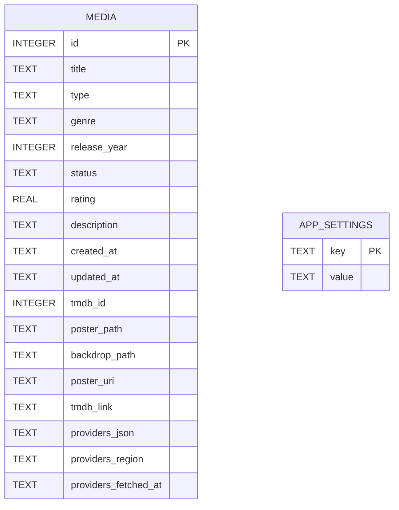
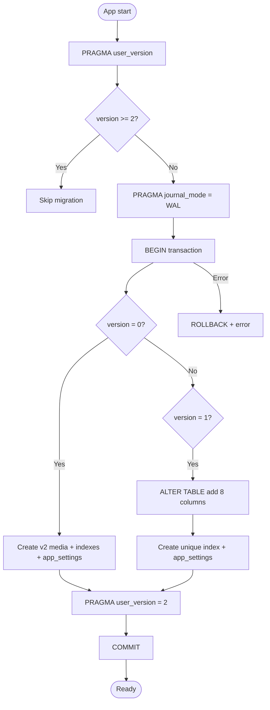

# CineTrack — Database Design & ERD

**Document ID:** CT-DB-001\
**Version:** 2.0\
**Status:** Final\
**Phase:** 3 — System Design\
**Project:** CineTrack\
**Last updated:** 2026-11-28

## Revision History

| Version | Date | Summary | Reason |
| --- | --- | --- | --- |
| 2.0 | 2026-11-28 | Added v2 media columns, `app_settings`, unique `(tmdb_id,type)`, v1→v2 migration and backward-compatibility notes | Lecturer consultation + UX fixes |
| 1.0 | 2026-11-25 | Initial single-table media schema | Project setup |

---

## 1. Entity Relationship Diagram



`media` and `app_settings` are independent tables; there is no foreign key. `app_settings` stores global preferences (`region`, `subscriptions`).

## 2. SQLite Schema v2

### 2.1 Fresh install (`user_version = 0`)

```sql
PRAGMA journal_mode = WAL;

CREATE TABLE IF NOT EXISTS media (
    id INTEGER PRIMARY KEY AUTOINCREMENT,

    title TEXT NOT NULL CHECK (length(trim(title)) > 0),
    type TEXT NOT NULL CHECK (type IN ('MOVIE', 'SERIES')),
    genre TEXT,
    release_year INTEGER,
    status TEXT NOT NULL DEFAULT 'TO_WATCH'
        CHECK (status IN ('TO_WATCH', 'WATCHING', 'COMPLETED')),
    rating REAL CHECK (rating IS NULL OR rating BETWEEN 1 AND 5),
    description TEXT,

    created_at TEXT NOT NULL DEFAULT CURRENT_TIMESTAMP,
    updated_at TEXT NOT NULL DEFAULT CURRENT_TIMESTAMP,

    tmdb_id INTEGER,
    poster_path TEXT,
    backdrop_path TEXT,
    poster_uri TEXT,
    tmdb_link TEXT,
    providers_json TEXT,
    providers_region TEXT,
    providers_fetched_at TEXT
);

CREATE INDEX IF NOT EXISTS idx_media_status ON media(status);
CREATE INDEX IF NOT EXISTS idx_media_type ON media(type);

CREATE UNIQUE INDEX IF NOT EXISTS idx_media_tmdb
    ON media(tmdb_id, type) WHERE tmdb_id IS NOT NULL;

CREATE TABLE IF NOT EXISTS app_settings (
    key TEXT PRIMARY KEY,
    value TEXT NOT NULL
);

PRAGMA user_version = 2;
```

### 2.2 Existing v1 database (`user_version = 1`)

```sql
ALTER TABLE media ADD COLUMN tmdb_id INTEGER;
ALTER TABLE media ADD COLUMN poster_path TEXT;
ALTER TABLE media ADD COLUMN backdrop_path TEXT;
ALTER TABLE media ADD COLUMN poster_uri TEXT;
ALTER TABLE media ADD COLUMN tmdb_link TEXT;
ALTER TABLE media ADD COLUMN providers_json TEXT;
ALTER TABLE media ADD COLUMN providers_region TEXT;
ALTER TABLE media ADD COLUMN providers_fetched_at TEXT;

CREATE UNIQUE INDEX IF NOT EXISTS idx_media_tmdb
    ON media(tmdb_id, type) WHERE tmdb_id IS NOT NULL;

CREATE TABLE IF NOT EXISTS app_settings (
    key TEXT PRIMARY KEY,
    value TEXT NOT NULL
);

PRAGMA user_version = 2;
```

Both paths are executed inside `db.withTransactionAsync`, so a failure rolls back. `PRAGMA journal_mode = WAL` runs outside the transaction because SQLite cannot change journal mode inside one.

## 3. Migration Strategy



**Rules**

- Never edit an existing migration block after release; add `currentVersion === 2` etc.
- Fresh install and upgrade must end with an identical schema.
- No table rebuild, no column drops, no data copy → v1 rows are untouched.
- New columns are nullable; old rows remain valid and render with genre placeholders.

**Verified migration test (2026-11-28, `node:sqlite`)**

- Fresh install: `user_version = 2`, 18 `media` columns, `app_settings`, `idx_media_tmdb`.
- v1 with a `COMPLETED` 4.5-rated row → v2: row preserved (`title`, `status`, `rating` unchanged), 18 columns, new table/index present.
- Duplicate `(tmdb_id, type)` insert is rejected by the unique index.

## 4. Unique Constraint & Duplicate Rules

- `(tmdb_id, type)` is unique only when `tmdb_id IS NOT NULL` (partial index).
- Manual items without a TMDB id are never blocked.
- Import deduplication uses:
  - `tmdb_id|type` when `tmdb_id` exists;
  - otherwise `title|type|release_year` (case-insensitive title).
- This allows a movie and a series with the same TMDB id (rare but possible in TMDB namespaces) and prevents duplicate online adds.

## 5. Column Notes

| Column | Notes |
| --- | --- |
| `updated_at` | Set by application `UPDATE`; SQLite does not auto-update. Provider cache updates intentionally **do not** change it. |
| `poster_path` | TMDB path (e.g. `/abc.jpg`), portable across devices. |
| `backdrop_path` | TMDB backdrop path, portable. |
| `poster_uri` | `file://` path in app documents; not portable, excluded from backup. |
| `tmdb_link` | TMDB/JustWatch watch page (or TMDB detail page). |
| `providers_json` | JSON with `stream`, `free`, `rent`, `buy`, `link`. |
| `providers_region` | Region used when the cache was fetched. |
| `providers_fetched_at` | ISO timestamp; stale after 7 days. |

## 6. Query Reference

| Operation | SQL |
| --- | --- |
| Get all | `SELECT * FROM media ORDER BY updated_at DESC, id DESC;` |
| Get by id | `SELECT * FROM media WHERE id = ?;` |
| Find by TMDB | `SELECT * FROM media WHERE tmdb_id = ? AND type = ?;` |
| Insert | `INSERT INTO media (title, type, genre, release_year, status, rating, description, tmdb_id, poster_path, backdrop_path, poster_uri, tmdb_link, providers_json, providers_region, providers_fetched_at) VALUES (?, ?, ?, ?, ?, ?, ?, ?, ?, ?, ?, ?, ?, ?, ?);` |
| Update | `UPDATE media SET title=?, type=?, genre=?, release_year=?, status=?, rating=?, description=?, tmdb_id=?, poster_path=?, backdrop_path=?, poster_uri=?, tmdb_link=?, providers_json=?, providers_region=?, providers_fetched_at=?, updated_at=CURRENT_TIMESTAMP WHERE id=?;` |
| Update providers | `UPDATE media SET providers_json=?, providers_region=?, providers_fetched_at=? WHERE id=?;` |
| Delete | `DELETE FROM media WHERE id = ?;` |
| Settings get | `SELECT value FROM app_settings WHERE key = ?;` |
| Settings upsert | `INSERT INTO app_settings (key, value) VALUES (?, ?) ON CONFLICT(key) DO UPDATE SET value = excluded.value;` |
| Statistics | `SELECT COUNT(*) AS total, SUM(type = 'MOVIE') AS movies, SUM(type = 'SERIES') AS series, SUM(status = 'TO_WATCH') AS to_watch, SUM(status = 'WATCHING') AS watching, SUM(status = 'COMPLETED') AS completed FROM media;` |

All queries use parameters (`?`); user input is never concatenated into SQL.

## 7. Backup Compatibility

- Backup v2 exports portable fields: `title, type, genre, release_year, status, rating, description, tmdb_id, poster_path, backdrop_path, tmdb_link, created_at, updated_at`.
- It excludes `poster_uri` and `providers_*`.
- Backup v1 import works because all new fields are optional and `mediaToFormData` tolerates missing keys.
- Import runs inserts inside a transaction; existing rows are kept.

## 8. Design Decisions

| Decision | Reason |
| --- | --- |
| Single `media` table | Movies/series share attributes; simpler queries |
| Separate `app_settings` table | Key/value preferences without schema churn |
| Nullable new columns | Safe v1→v2 migration |
| Partial unique index | Prevent online duplicates without blocking manual entries |
| Provider cache in `media` | Single-row read for cards/details; no join |
| `poster_path` vs `poster_uri` | Portable metadata vs user-local file |
| No `updated_at` bump on provider refresh | Keep “Recent” ordering tied to user activity |
| WAL mode | Better concurrency/performance |

**End of Document**

Document ID: CT-DB-001\
Version: 2.0\
Project: CineTrack
