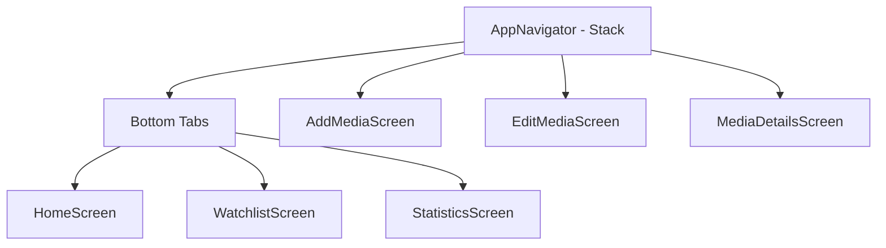

# CineTrack — Component Design

**Phase:** 3 — System Design\
**Document:** 12-component-design\
**Project:** CineTrack\
**Status:** Draft

Tujuan dokumen ini adalah menghindari satu file `App.js` yang berisi seluruh UI dan logic aplikasi.

## 1. Navigation Structure

Navigasi menggunakan React Navigation dengan dua level:



Bottom tab berisi tiga area utama (Home, Watchlist, Statistics). Add, Edit, dan Details dibuka di atas tab sebagai stack screen.

## 2. Screen Components

| Component          | Responsibility               |
| ------------------ | ---------------------------- |
| HomeScreen         | Dashboard dan recently added |
| WatchlistScreen    | Collection, search, filter   |
| StatisticsScreen   | Collection statistics        |
| AddMediaScreen     | Add form                     |
| EditMediaScreen    | Edit form                    |
| MediaDetailsScreen | Detail tontonan              |

## 3. Reusable Components

| Component        | Responsibility                 |
| ---------------- | ------------------------------ |
| MediaCard        | Menampilkan satu item          |
| SearchBar        | Input pencarian                |
| FilterTabs       | Filter Movie / Series          |
| StatusFilter     | Filter viewing status          |
| StatusBadge      | Menampilkan status             |
| RatingInput      | Input rating                   |
| MediaForm        | Form add/edit                  |
| EmptyState       | Tampilan ketika tidak ada data |
| ConfirmDialog    | Konfirmasi penghapusan         |
| BottomNavigation | Navigasi utama                 |

`BottomNavigation` disediakan oleh bottom tab navigator di `AppNavigator.js`, dengan styling dark theme dari `constants/colors.js`.

## 4. Proposed Project Structure

```
CineTrack/
│
├── docs/
│
├── assets/
│   ├── images/
│   └── icons/
│
├── src/
│   ├── components/
│   │   ├── MediaCard.js
│   │   ├── SearchBar.js
│   │   ├── FilterTabs.js
│   │   ├── StatusFilter.js
│   │   ├── StatusBadge.js
│   │   ├── RatingInput.js
│   │   ├── MediaForm.js
│   │   ├── ConfirmDialog.js
│   │   └── EmptyState.js
│   │
│   ├── screens/
│   │   ├── HomeScreen.js
│   │   ├── WatchlistScreen.js
│   │   ├── StatisticsScreen.js
│   │   ├── AddMediaScreen.js
│   │   ├── EditMediaScreen.js
│   │   └── MediaDetailsScreen.js
│   │
│   ├── navigation/
│   │   └── AppNavigator.js
│   │
│   ├── database/
│   │   ├── database.js
│   │   └── mediaRepository.js
│   │
│   ├── services/
│   │   ├── mediaService.js
│   │   └── validationService.js
│   │
│   ├── hooks/
│   │   └── useMedia.js
│   │
│   ├── constants/
│   │   ├── colors.js
│   │   └── mediaOptions.js
│   │
│   └── utils/
│       └── formatters.js
│
├── App.js
├── app.json
├── package.json
└── README.md
```

**Mengapa struktur ini?**

- `components/`: UI yang bisa digunakan berulang kali.
- `screens/`: halaman aplikasi.
- `navigation/`: pengaturan navigasi.
- `database/`: koneksi SQLite dan operasi database.
- `services/`: business logic.
- `hooks/`: reusable stateful logic.
- `constants/`: nilai konfigurasi.
- `utils/`: helper functions.

Struktur ini cukup modular tetapi tidak berlebihan untuk aplikasi mahasiswa.

## 5. Phase 3 Deliverables

Struktur dokumentasi final yang disimpan di folder `docs/`:

```
docs/
├── 01-project-planning.md
├── 02-srs.md
├── 03-use-case.md
├── 04-requirement-traceability.md
├── 05-user-flow.md
├── 06-wireframes.md
├── 07-activity-diagrams.md
├── 08-sequence-diagrams.md
├── 09-system-architecture.md
├── 10-database-design.md
├── 11-data-dictionary.md
└── 12-component-design.md
```

Penomoran Phase 3 dimulai dari 05 agar tidak bertabrakan dengan RTM Phase 2.
