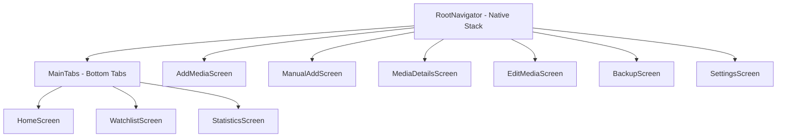

# CineTrack — Component Design

**Document ID:** CT-CD-001\
**Version:** 2.0\
**Status:** Final\
**Phase:** 3 — System Design\
**Project:** CineTrack\
**Last updated:** 2026-11-28

## Revision History

| Version | Date | Summary | Reason |
| --- | --- | --- | --- |
| 2.0 | 2026-11-28 | Added poster/provider/card/sheet/settings components, genre theme table, updated folder structure and navigation | Lecturer consultation + UX fixes |
| 1.0 | 2026-11-25 | Initial component and folder design | Project setup |

---

## 1. Navigation Structure



Bottom tabs are the three primary areas. Add, Manual Add, Details, Edit, Backup, and Settings open above the tabs.

## 2. Screen Components

| Screen | Responsibility | Key dependencies |
| --- | --- | --- |
| `HomeScreen` | Status summary, Continue Watching, Up Next, Recently Completed, Settings entry | `PosterCarousel`, `MediaCard`, `EmptyState` |
| `WatchlistScreen` | Collection, search, filter sheet/chips, card actions, rating sheet, undo delete | `SearchBar`, `FilterSheet`, `ActionSheet`, `RatingSheet`, `MediaCard` |
| `AddMediaScreen` | Search-first TMDB add, duplicate badges, offline banner, manual link | `useTmdbSearch`, `TmdbSearchResultItem`, `ConfirmAddSheet` |
| `ManualAddScreen` | Offline manual add (title only required) | `MediaForm` |
| `MediaDetailsScreen` | Hero, rating, status, where to watch, synopsis, edit/delete | `BackdropImage`, `PosterImage`, `ProviderSection`, `RatingSheet` |
| `EditMediaScreen` | Edit + “Find poster & info automatically” | `MediaForm`, `TmdbSearchSheet` |
| `StatisticsScreen` | Totals/average/status/type bars | `getStatistics` |
| `SettingsScreen` | Region, subscriptions, enrichment progress/review, backup, cache, credits | `RegionPicker`, `SubscriptionPicker` |
| `BackupScreen` | Export/import JSON backup | `buildBackup`, `parseBackup`, `importBackup` |

## 3. Component Inventory

### 3.1 Media & posters

| Component | Responsibility | Main props |
| --- | --- | --- |
| `PosterImage` | Priority `poster_uri` → TMDB `poster_path` → placeholder; fallback on load error | `media`, `style`, `size`, `contentFit`, `recyclingKey`, `transition` |
| `PosterPlaceholder` | Genre gradient + icon + initials | `media`, `style`, `iconSize` |
| `BackdropImage` | Backdrop → poster → placeholder; used in hero/cinematic cards | `media`, `style`, `transition` |
| `PosterPicker` | Pick a 2:3 image from gallery, copy to documents, preview/remove | `value`, `genre`, `title`, `onChange` |
| `PosterCarousel` | Horizontal poster list for Home sections | `data`, `onPress`, `emptyLabel` |
| `GenreIcon` | Maps theme icon names to Lucide components | `name`, `size`, `color`, `strokeWidth` |

### 3.2 Cards

| Component | Responsibility |
| --- | --- |
| `MediaCard` | Dispatcher: chooses the variant from `getGenreTheme(media.genre)` and computes shared card data |
| `MediaCardCinematic` | Wide 16:9 backdrop card for Action/Adventure/Thriller/Crime/War/Western |
| `MediaCardPoster` | Poster-left/info-right neutral card for Drama/Mystery/History/Documentary |
| `MediaCardVibrant` | Rounded tinted card with sticker icon for Comedy/Animation/Family/Music |
| `MediaCardAtmospheric` | Glow-border card for Horror/Sci-Fi/Fantasy/Romance |
| `CardPieces` | `CardRating`, `CardMeta`, `CardOverflowButton` |
| `CardStreaming` | Primary provider button + secondary logos |
| `StatusBadge` | Colored status pill |
| `GenreList` / `GenreChip` | Genre chips (max N, colored) |

All variants show: title, type · year, rating, status, max 2 genre chips, and a streaming action when available. `MediaCard` and variants are `React.memo`ized.

### 3.3 Providers

| Component | Responsibility | Main props |
| --- | --- | --- |
| `ProviderLogo` | Circular TMDB logo with fallback icon | `provider`, `size`, `borderColor` |
| `ProviderButton` | Primary “Open on …” / “Rent/Buy on …” button, opens link safely | `provider`, `kind`, `media`, `tmdbLink`, `accent`, `compact` |
| `ProviderLogos` | Up to 3 tappable secondary logos | `providers`, `media`, `tmdbLink` |
| `ProviderSection` | Detail groups + updated-at + refresh | `providers`, `media`, `region`, `fetchedAt`, `isRefreshing`, `onRefresh`, `isConfigured` |

### 3.4 Sheets / modals / feedback

| Component | Responsibility |
| --- | --- |
| `ModalSheet` | Shared bottom sheet (`Modal`, handle, title, close, scroll, keyboard avoidance) |
| `ConfirmAddSheet` | Poster/title/year/genres/synopsis + status + optional rating + Add |
| `FilterSheet` | Type/status/genre/sort with Reset/Apply |
| `ActionSheet` | Generic action list with icons/submenus/destructive styling |
| `RatingSheet` | Skippable rating on Completed |
| `RegionPicker` | Country list + custom ISO code |
| `SubscriptionPicker` | Multi-select providers for the region (catalog or fallback) |
| `TmdbSearchSheet` | TMDB search inside Edit |
| `SnackbarProvider` | One snackbar with optional action (Undo), animated with `Animated` |
| `OfflineBanner` | Informational offline/token banner (not a red error) |

### 3.5 Forms, filters, layout

| Component | Responsibility |
| --- | --- |
| `MediaForm` | Title (required), type, status, collapsible “More details” (genre/year/rating/description/poster) |
| `CollapsibleSection` | Expand/collapse optional fields |
| `CollapsibleText` | Synopsis with Read more/Show less |
| `StatusSegmented` | Three-status segmented control |
| `SearchBar` | Search input with clear button and optional autofocus |
| `ActiveFilterChips` | Removable active-filter chips |
| `EmptyState` | Title/message + optional CTA |
| `FloatingAddButton` | Global + button |
| `GenrePicker` | Multi-select genre bottom sheet |
| `YearPicker` | Searchable year panel |
| `RatingInput` | 1–5 rating stepper (0.5) |

### 3.6 Hooks

| Hook | Responsibility |
| --- | --- |
| `useMedia` | Access `MediaContext` |
| `useCardMedia` | Memoized card model: providers, primary/secondary, genres, labels |
| `useDebouncedValue` | 400 ms debounce for search |
| `useTmdbSearch` | Cancellable TMDB search state machine |
| `useSnackbar` | Access snackbar context |

## 4. Genre → Theme Table

Primary genre priority: Horror > Sci-Fi > Fantasy > Animation > Romance > Comedy > Thriller > Crime > War > Western > Action > Adventure > Music > Documentary > History > Mystery > Family > Drama.

| Genre | Variant | Accent source | Gradient | Icon | Radius |
| --- | --- | --- | --- | --- | --- |
| Horror | atmospheric | `#FB7185` | `#250607 → #000000` | ghost | 10 |
| Sci-Fi | atmospheric | `#22D3EE` | `#04202A → #000000` | rocket | 10 |
| Fantasy | atmospheric | `#E879F9` | `#1D0B2E → #000000` | sparkles | 10 |
| Romance | atmospheric | `#F472B6` | `#2A0B1A → #000000` | heart | 10 |
| Comedy | vibrant | `#FACC15` | `#30280A → surface` | laugh | 16 |
| Animation | vibrant | `#A3E635` | `#18270A → surface` | clapperboard | 16 |
| Family | vibrant | `#4ADE80` | `#0C2614 → surface` | users | 16 |
| Music | vibrant | `#2DD4BF` | `#072824 → surface` | music | 16 |
| Action | cinematic | `#F87171` | `#2A0707 → background` | flame | 8 |
| Adventure | cinematic | `#FB923C` | `#2A1405 → background` | compass | 8 |
| Thriller | cinematic | `#60A5FA` | `#0A1526 → background` | eye | 8 |
| Crime | cinematic | `#94A3B8` | `#161B22 → background` | fingerprint | 8 |
| War | cinematic | `#34D399` | `#0B1F16 → background` | swords | 8 |
| Western | cinematic | `#D4A373` | `#241505 → background` | sunset | 8 |
| Drama | poster | `#818CF8` | surface → background | film | 8 |
| Mystery | poster | `#A78BFA` | surface → background | search | 8 |
| History | poster | `#FBBF24` | surface → background | hourglass | 8 |
| Documentary | poster | `#A8A29E` | `#1B1B18 → background` | book-open | 4 |
| No genre | poster | `colors.border` | surface → background | film | 8 |

Theme shape: `{ variant, accent, gradient: [from, to], icon, radius }`.

## 5. Design Patterns

- **Dispatcher card:** `MediaCard` picks a variant, so list code does not branch on genre.
- **Shared card model:** `useCardMedia` prevents duplicated provider/genre logic.
- **Pure services:** mapping/normalization/filter functions are unit-testable.
- **Single request gateway:** `tmdbClient` centralizes timeout/retry/auth errors.
- **Context actions:** screens call `addFromTmdb`, `refreshProviders`, `enrichItems`, etc.; they never import a `fetch` wrapper.
- **Modal sheets:** native `Modal` only; no reanimated or external sheet library.
- **Accessibility:** 44 dp minimum touch targets; icon buttons have labels.
- **Memoization:** cards are memoized; images use `recyclingKey` + disk cache.

## 6. Folder Structure (actual)

```
src/
├── components/
│   ├── ActionSheet.js
│   ├── ActiveFilterChips.js
│   ├── BackdropImage.js
│   ├── CardPieces.js
│   ├── CardStreaming.js
│   ├── CollapsibleSection.js
│   ├── CollapsibleText.js
│   ├── ConfirmAddSheet.js
│   ├── EmptyState.js
│   ├── FilterSheet.js
│   ├── FloatingAddButton.js
│   ├── GenreChip.js
│   ├── GenreIcon.js
│   ├── GenreList.js
│   ├── GenrePicker.js
│   ├── MediaCard.js
│   ├── MediaCardAtmospheric.js
│   ├── MediaCardCinematic.js
│   ├── MediaCardPoster.js
│   ├── MediaCardVibrant.js
│   ├── MediaForm.js
│   ├── ModalSheet.js
│   ├── OfflineBanner.js
│   ├── PosterCarousel.js
│   ├── PosterImage.js
│   ├── PosterPicker.js
│   ├── PosterPlaceholder.js
│   ├── ProviderButton.js
│   ├── ProviderLogo.js
│   ├── ProviderLogos.js
│   ├── ProviderSection.js
│   ├── RatingInput.js
│   ├── RatingSheet.js
│   ├── RegionPicker.js
│   ├── SearchBar.js
│   ├── StatusBadge.js
│   ├── StatusSegmented.js
│   ├── SubscriptionPicker.js
│   ├── TmdbSearchResultItem.js
│   ├── TmdbSearchSheet.js
│   └── YearPicker.js
├── config/env.js
├── constants/
│   ├── appInfo.js
│   ├── colors.js
│   ├── genres.js
│   ├── genreThemes.js
│   ├── mediaOptions.js
│   ├── spacing.js
│   ├── streamingProviders.js
│   ├── typography.js
│   └── years.js
├── context/
│   ├── MediaContext.js
│   └── SnackbarContext.js
├── database/
│   ├── database.js
│   ├── mediaRepository.js
│   └── settingsRepository.js
├── hooks/
│   ├── useCardMedia.js
│   ├── useDebouncedValue.js
│   ├── useMedia.js
│   ├── useSnackbar.js
│   └── useTmdbSearch.js
├── navigation/
│   ├── RootNavigator.js
│   └── TabNavigator.js
├── screens/
│   ├── AddMediaScreen.js
│   ├── BackupScreen.js
│   ├── EditMediaScreen.js
│   ├── HomeScreen.js
│   ├── ManualAddScreen.js
│   ├── MediaDetailsScreen.js
│   ├── SettingsScreen.js
│   ├── StatisticsScreen.js
│   └── WatchlistScreen.js
├── services/
│   ├── mediaService.js
│   ├── providerService.js
│   ├── tmdbClient.js
│   ├── tmdbMapper.js
│   └── validationService.js
└── utils/
    ├── files.js
    ├── formatters.js
    └── links.js
```

## 7. Removed / Renamed

| Item | Status | Reason |
| --- | --- | --- |
| `FilterTabs.js` | Removed | Replaced by `FilterSheet` |
| `StatusFilter.js` | Removed | Replaced by `FilterSheet` |
| `SortSelector.js` | Removed | Replaced by `FilterSheet` |
| `utils/alerts.js` | Removed | Delete confirmations are screen-specific (with Undo) |
| `BackupScreen.js.bak` | Removed | Unused legacy backup file |
| `GenreChip` / `GenreList` | Kept | Still used by cards/details/picker |
| `GenrePicker` | Kept | Used in manual/edit form |
| `YearPicker` | Kept | Used in form |
| `RatingInput` | Kept | Used in form/rating sheet |

## 8. Documentation Deliverables

```
docs/
├── 01-project-planning.md
├── 02-srs.md
├── 03-use-case.md
├── 04-requirement-traceability.md
├── 05-user-flow.md
├── 06-wireframes.md
├── 07-activity-diagrams.md
├── 08-sequence-diagrams.md
├── 09-system-architecture.md
├── 10-database-design.md
├── 11-data-dictionary.md
├── 12-component-design.md
├── 13-implementation-plan.md
├── 14-external-api-integration.md
└── 15-decision-log.md
```

**End of Document**

Document ID: CT-CD-001\
Version: 2.0\
Project: CineTrack
