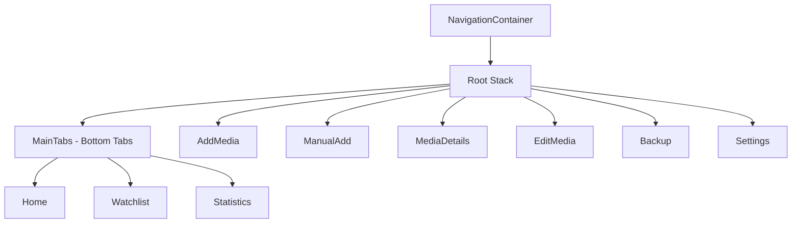

# CineTrack — Implementation Plan

**Document ID:** CT-IMP-001\
**Version:** 2.1\
**Status:** Final\
**Phase:** 4 — Implementation Planning\
**Baseline:** Phase 3 — System Design\
**Last updated:** 2026-11-28

## Revision History

| Version | Date | Summary | Reason |
| --- | --- | --- | --- |
| 2.1 | 2026-11-28 | Added M21 Responsive/Adaptive UI Fix; shared BottomSheet, ScreenContainer, keyboard hook, layout tokens, FAB layering | Perbaikan responsive UI |
| 2.0 | 2026-11-28 | New dependencies, DB v2, TMDB/provider services, milestones M14–M20, real implementation status, QA results | Lecturer consultation + UX fixes |
| 1.0 | 2026-11-25 | Initial implementation plan | Project setup |

---

## 1. Technology Stack

| Technology | Package / Tool | Purpose |
| --- | --- | --- |
| Framework | React Native 0.88.1 | Mobile application |
| Runtime | Expo SDK 58.1.0 | Development/runtime |
| Language | JavaScript | Application logic |
| Navigation | React Navigation 7 | Stack + bottom tabs |
| Database | SQLite / expo-sqlite | Local persistence (v2) |
| State | React Context + hooks | Collection, settings, snackbar |
| Online metadata | TMDB API v3 | Search/details/posters/providers |
| Images | expo-image | Disk cache + recycling |
| Gradients | expo-linear-gradient | Genre themes/overlays |
| Poster picker | expo-image-picker | Custom poster from gallery |
| Region | expo-localization | Default region |
| Files | expo-file-system | Copy/delete poster files |
| Backup I/O | expo-document-picker + expo-sharing | JSON export/import |
| Icons | lucide-react-native | Icons |
| Styling | React Native StyleSheet | UI styling |
| Tests | jest-expo 58 + jest 30 | Pure-function tests |
| Lint | eslint 9 + eslint-config-expo 58 | Quality |
| Version control | Git + GitHub | Source management |

## 2. Dependencies

### 2.1 Runtime

| Package | Version (package.json) | Notes |
| --- | --- | --- |
| `expo` | `~58.1.0` | SDK |
| `react` | `19.3.0` | |
| `react-native` | `0.88.1` | |
| `@react-navigation/native` | `^7.5.2` | |
| `@react-navigation/bottom-tabs` | `^7.22.0` | |
| `@react-navigation/native-stack` | `^7.21.1` | |
| `react-native-screens` | `~4.30.1` | |
| `react-native-safe-area-context` | `~5.11.1` | |
| `expo-sqlite` | `~58.0.18` | DB |
| `expo-image` | `~58.0.19` | Posters/backdrops/logos |
| `expo-linear-gradient` | `~58.0.4` | Themes |
| `expo-image-picker` | `~58.0.10` | Custom poster |
| `expo-localization` | `~58.0.5` | Region |
| `expo-file-system` | `~58.0.15` | Poster files |
| `expo-document-picker` | `~58.0.5` | Backup import |
| `expo-sharing` | `~58.0.24` | Backup export |
| `expo-status-bar` | `~58.0.5` | Status bar |
| `lucide-react-native` | `^1.80.0` | Icons |
| `react-native-svg` | `15.16.0` | Lucide dependency |

### 2.2 Development

| Package | Version | Purpose |
| --- | --- | --- |
| `jest` | `~30.5.2` | Test runner |
| `jest-expo` | `~58.0.16` | Expo Jest preset |
| `eslint` | `^9.0.0` | Lint |
| `eslint-config-expo` | `~58.0.4` | Expo flat config |

**Installation rule:** native packages must use `npx expo install`. Do not use `npm install` for Expo modules.

## 3. Project Initialization

Expo managed workflow, blank JavaScript template.

```bash
npx create-expo-app@latest CineTrack --template blank
cd CineTrack
npm install
npx expo install expo-sqlite react-native-screens react-native-safe-area-context react-native-svg
npm install @react-navigation/native @react-navigation/bottom-tabs @react-navigation/native-stack lucide-react-native
```

v2 additions:

```bash
npx expo install expo-image expo-linear-gradient expo-image-picker expo-localization
npx expo install jest-expo jest --dev
```

## 4. Final Project Structure

See `docs/12-component-design.md` §6 for the full tree. Main layers:

```
src/
├── components/     UI: cards, sheets, posters, providers, forms
├── config/         env (TMDB token)
├── constants/      colors, spacing, genres, themes, providers
├── context/        MediaContext, SnackbarContext
├── database/       database.js, mediaRepository, settingsRepository
├── hooks/          useMedia, useCardMedia, useTmdbSearch, …
├── navigation/     RootNavigator, TabNavigator
├── screens/        Home, Watchlist, Add, ManualAdd, Details, Edit,
│                   Statistics, Settings, Backup
├── services/       mediaService, tmdbClient, tmdbMapper,
│                   providerService, validationService
└── utils/          formatters, files, links
```

## 5. Navigation Strategy



Rules:

- Add/Manual/Details/Edit/Backup/Settings are stack screens, not tabs.
- Home status cards navigate to Watchlist with a status param; Watchlist applies it once and clears it.
- Deep screens return via `goBack`.

## 6. State Management Strategy

| State | Location | Persistence |
| --- | --- | --- |
| Collection | `MediaContext` | SQLite |
| Region | `MediaContext` + `app_settings` | SQLite |
| Subscriptions | `MediaContext` + `app_settings` | SQLite |
| Snackbar | `SnackbarContext` | Memory |
| Search query/results | `useTmdbSearch` | Memory |
| Filters/sort | `WatchlistScreen` | Memory (not persisted) |
| Provider cache | `media.providers_*` | SQLite |
| Images | `expo-image` | Disk/memory cache |
| Custom posters | documents + `poster_uri` | Device file system |

**Flow on mutation:** validate → service → repository → SQLite → context refresh → UI.

**Background refresh:** after settings/collection load, refresh at most 20 `TO_WATCH`/`WATCHING` items with stale/region-mismatched provider caches, sequential with 250 ms delay, failures logged silently.

## 7. Milestones & Real Status

| Milestone | Task | Priority | Related Requirements | Status |
| --- | --- | --- | --- | --- |
| M1 | Project initialization | Must | — | Done |
| M2 | Install dependencies | Must | NFR-07 | Done |
| M3 | Folder structure | Must | NFR-08 | Done |
| M4 | Theme & reusable components | Must | NFR-05 | Done |
| M5 | Navigation setup | Must | NFR-04 | Done |
| M6 | SQLite initialization | Must | NFR-02, NFR-03 | Done |
| M7 | Create & Read | Must | FR-01, FR-02, FR-06 | Done |
| M8 | Update & Delete | Must | FR-03, FR-04, FR-05 | Done |
| M9 | Search & Filter | Must | FR-07, FR-08, FR-09 | Done |
| M10 | Rating functionality | Must | FR-10 | Done |
| M11 | Statistics | Should | FR-11 | Done |
| M12 | Sorting | Could | FR-13 | Done |
| M13 | Testing & bug fixing | Must | All | Done (unit/migration/bundle) |
| M14 | Database v2 migration | Must | FR-15…FR-18, FR-22, FR-24 | Done |
| M15 | TMDB service & genre mapping | Must | FR-14, FR-15, FR-17 | Done |
| M16 | Search-first Add flow | Must | FR-02, FR-14, FR-15, FR-16 | Done |
| M17 | Posters & genre-themed cards | Must | FR-16, FR-19 | Done |
| M18 | Home, Watchlist, Detail UX | Must | FR-01, FR-07…FR-09, FR-12, FR-13, FR-17, FR-18, FR-20, FR-21 | Done |
| M19 | Settings, enrichment, background refresh | Should | FR-22, FR-23 | Done |
| M20 | Documentation & QA | Must | NFR-08, NFR-10 | Done |
| M21 | Responsive/Adaptive UI Fix | Must | NFR-13, FR-10, FR-17, FR-18 | Done (code/bundle; device matrix pending) |

### M14–M21 Details

**M14 — Database v2**

- `DATABASE_VERSION = 2`.
- 8 new columns, partial unique index, `app_settings`.
- Fresh install and v1→v2 produce identical schemas.
- Settings repository with upsert.

**M15 — TMDB & mapping**

- `tmdbClient`: 8 s timeout, one retry, 401/429 mapping, abort support.
- `tmdbMapper`: genre ID mapping for movie/TV; search/details → form/payload.
- `providerService`: normalization, primary/secondary provider, link builder, TTL.
- `streamingProviders`: verified templates; provider IDs from TMDB.
- 32 Jest tests.

**M16 — Search-first Add**

- Debounced search (400 ms, min 2 chars).
- Confirm sheet with status/optional rating.
- Duplicate detection and friendly error.
- Manual fallback screen and offline banners.
- Snackbar feedback.

**M17 — Posters & cards**

- `PosterImage`/`PosterPlaceholder`/`BackdropImage`.
- Four card variants + dispatcher + shared card model.
- Provider button/logos on cards.
- Memoization and FlatList tuning.

**M18 — UX**

- Home sections/carousels and empty CTA.
- Watchlist compact header + FilterSheet + chips + action sheet + rating sheet + undo.
- Details hero + where-to-watch + synopsis + rating.
- 44 dp touch targets and accessibility labels.

**M19 — Settings & enrichment**

- Region detection/settings, provider catalog, subscriptions.
- Enrichment progress/cancel/Needs review.
- Background provider refresh.
- Clear image cache and attribution.

**M20 — Docs & QA**

- README + AGENTS + docs 01–15 + CHANGELOG.
- Lint, tests, doctor, install check, Android export.
- DB migration verification with `node:sqlite`.

**M21 — Responsive/Adaptive UI Fix**

- Shared `BottomSheet` with nested SafeAreaProvider, keyboard height, sticky footer, max width.
- Shared `ScreenContainer` for keyboard-aware forms.
- `useKeyboardHeight`, `layout.js` tokens.
- Safe-area audit for tab bar, snackbar, FAB, YearPicker, content width.
- FAB absolute-fill overlay with high z-order/elevation and scroll clearance.
- RatingInput redesigned to 5 tappable stars (half/full) + Clear.
- Responsive poster carousel width, max content width 640, font-scaling guards.
- Documents updated to 2.1; device matrix TC-027…TC-036 pending user testing.

## 8. Git Workflow

Actual v2 commits (oldest → newest):

```text
feat: database v2 migration and extended media model
feat: tmdb integration, genre mapping and streaming provider services
feat: search-first add flow with manual fallback
feat: poster thumbnails, genre-themed card variants and streaming buttons
feat: home sections
feat: watchlist filter sheet and card actions
feat: media details hero and where-to-watch
feat: settings screen
feat: enrich existing titles and background provider refresh
refactor: remove unused legacy components and backup file
docs: revise all documents for v2 (tmdb, poster, streaming, genre cards)
```

Rules:

- `main` stays stable.
- Each phase/feature has its own commit.
- Lint/tests/doctor/export run before commits that complete a phase.
- Commit prefixes: `feat:`, `fix:`, `docs:`, `refactor:`.

## 9. Development Principles

1. Implement incrementally; keep the app runnable.
2. Preserve user data across migrations.
3. Keep SQL/fetch out of screens/components.
4. Validate before persistence.
5. Online features are optional; offline core must never break.
6. Prefer Expo modules and small local components.
7. Memoize cards and tune lists.
8. Document decisions and risks.

## 10. QA / Completion Criteria

- Lint passes with 0 errors.
- Jest suite passes.
- `expo-doctor` passes.
- `expo install --check` reports up to date.
- Android production export bundles successfully.
- DB v1→v2 migration preserves rows.
- No SQL/fetch in screens/components.
- All docs 01–15 + README/AGENTS/CHANGELOG are v2.0 and consistent.

**End of Document**

Document ID: CT-IMP-001\
Version: 2.1\
Project: CineTrack
