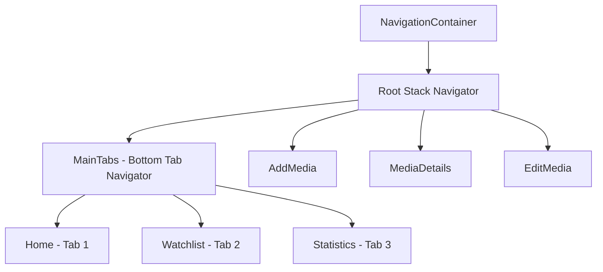
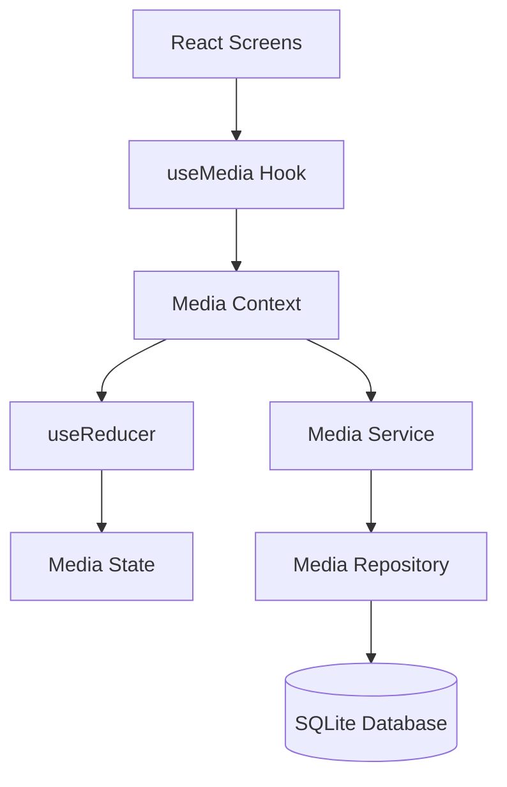
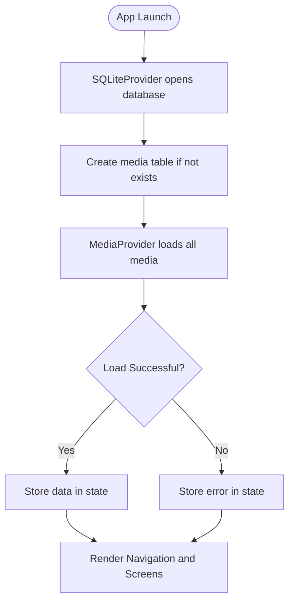

# CineTrack — Implementation Plan

**Document ID:** CT-IMP-001\
**Version:** 1.0\
**Status:** Draft\
**Phase:** 4 — Implementation Planning\
**Baseline:** Phase 3 — System Design

Dokumen ini menerjemahkan desain sistem (Phase 3) menjadi rencana implementasi project React Native yang dapat dijalankan. Hasil akhirnya adalah project structure, daftar dependency, strategi navigasi, strategi state management, rencana inisialisasi database, dan urutan development.

---

## 1. Technology Stack

| Technology         | Package / Tool             | Purpose                  |
| ------------------ | -------------------------- | ------------------------ |
| Framework          | React Native               | Mobile application       |
| Development        | Expo                       | Development environment  |
| Runtime            | Expo Go                    | Testing di Android       |
| Language           | JavaScript                 | Application logic        |
| Navigation         | React Navigation           | Navigasi halaman         |
| Database           | SQLite                     | Local database           |
| SQLite Integration | expo-sqlite                | Database operations      |
| State Management   | React Context + useReducer | Shared application state |
| Styling            | React Native StyleSheet    | UI styling               |
| Icons              | Lucide React Native        | Icons                    |
| Version Control    | Git + GitHub               | Source code management   |

### Keputusan Teknis

1. **JavaScript, bukan TypeScript.** Fokus pembelajaran tetap pada React Native, component lifecycle, navigation, dan CRUD.
2. **React Navigation.** Bottom Tab Navigator untuk navigasi utama dan Native Stack Navigator untuk halaman detail serta form.
3. **SQLite.** `expo-sqlite` digunakan untuk penyimpanan lokal yang persisten.
4. **React Context + useReducer.** Redux atau Zustand tidak diperlukan untuk aplikasi dengan kompleksitas ini.
5. **StyleSheet.** Styling bawaan React Native agar tidak menambah dependency styling yang belum diperlukan.

---

## 2. Dependencies & Package Selection

| Package                        | Installation | Priority            |
| ------------------------------ | ------------ | ------------------- |
| expo-sqlite                    | Expo install | Required            |
| @react-navigation/native       | npm install  | Required            |
| @react-navigation/bottom-tabs  | npm install  | Required            |
| @react-navigation/native-stack | npm install  | Required            |
| react-native-screens           | Expo install | Required            |
| react-native-safe-area-context | Expo install | Required            |
| lucide-react-native            | npm install  | Optional UI         |
| react-native-svg               | Expo install | Required for Lucide |

### Installation Strategy

Untuk native dependencies, gunakan `npx expo install` supaya versi package disesuaikan dengan Expo SDK proyek.

```bash
npx expo install expo-sqlite
npx expo install react-native-screens react-native-safe-area-context
npx expo install react-native-svg
```

Untuk React Navigation:

```bash
npm install @react-navigation/native
npm install @react-navigation/bottom-tabs
npm install @react-navigation/native-stack
```

Untuk Lucide:

```bash
npm install lucide-react-native
```

Dependency tidak dipasang sekaligus sebelum project dibuat. Dependency dipasang bertahap dan diperiksa kompatibilitasnya, sesuai risiko "Ketidaksesuaian Expo SDK dan library" di `01-project-planning.md`.

---

## 3. Project Initialization

Project menggunakan **Expo managed workflow** dengan template JavaScript minimal (bukan template yang sudah memiliki banyak fitur tambahan).

```bash
npx create-expo-app@latest CineTrack --template blank
cd CineTrack
npx expo start
```

Kemudian scan QR code menggunakan Expo Go pada Android.

| Tool               | Fungsi                                                        |
| ------------------ | ------------------------------------------------------------- |
| Expo Go            | Menjalankan aplikasi React Native langsung di smartphone      |
| Visual Studio Code | Code editor untuk pengembangan dan pengelolaan project        |

**Catatan:** Expo Go digunakan sebagai development runtime. Tidak dibutuhkan backend atau server tambahan untuk menjalankan aplikasi ini.

---

## 4. Final Project Structure

Berdasarkan arsitektur Phase 3 (`09-system-architecture.md` dan `12-component-design.md`):

```
CineTrack/
│
├── docs/
│   ├── 01-project-planning.md
│   ├── 02-srs.md
│   ├── 03-use-case.md
│   ├── 04-requirement-traceability.md
│   ├── 05-user-flow.md
│   ├── 06-wireframes.md
│   ├── 07-activity-diagrams.md
│   ├── 08-sequence-diagrams.md
│   ├── 09-system-architecture.md
│   ├── 10-database-design.md
│   ├── 11-data-dictionary.md
│   ├── 12-component-design.md
│   └── 13-implementation-plan.md
│
├── assets/
│   ├── images/
│   └── icons/
│
├── src/
│   ├── components/
│   ├── screens/
│   ├── navigation/
│   ├── database/
│   │   ├── database.js
│   │   └── mediaRepository.js
│   ├── services/
│   │   ├── mediaService.js
│   │   └── validationService.js
│   ├── context/
│   │   └── MediaContext.js
│   ├── hooks/
│   │   └── useMedia.js
│   ├── constants/
│   │   ├── colors.js
│   │   └── mediaOptions.js
│   └── utils/
│       └── formatters.js
│
├── App.js
├── app.json
├── package.json
└── README.md
```

Folder `context/` ditambahkan dibanding Phase 3 karena state management menggunakan React Context + useReducer. Isi `components/` dan `screens/` mengikuti `12-component-design.md`.

---

## 5. Navigation Strategy

Navigasi menggunakan dua navigator.



### Navigation Rules

| Screen       | Navigator  | Purpose      |
| ------------ | ---------- | ------------ |
| Home         | Bottom Tab | Dashboard    |
| Watchlist    | Bottom Tab | Collection   |
| Statistics   | Bottom Tab | Statistics   |
| AddMedia     | Root Stack | Create entry |
| MediaDetails | Root Stack | View details |
| EditMedia    | Root Stack | Update entry |

### Navigation Flow

```
Home
 ├── Add Media
 ├── Watchlist
 │    └── Media Details
 │         ├── Edit Media
 │         └── Delete
 └── Statistics
```

Dengan pendekatan ini, halaman Add dan Edit tidak perlu menjadi tab permanen. Alur ini konsisten dengan `05-user-flow.md`.

---

## 6. State Management Strategy

Menggunakan React Context API dan `useReducer`. Data collection diakses oleh beberapa screen sekaligus; jika setiap halaman memiliki state sendiri, data bisa menjadi tidak konsisten.

### State yang Dikelola

**Shared state (Context):**

| State     | Purpose                 |
| --------- | ----------------------- |
| mediaList | Seluruh koleksi         |
| isLoading | Status loading database |
| error     | Menyimpan error         |

**Screen-specific state (di `WatchlistScreen`):**

| State          | Purpose               |
| -------------- | --------------------- |
| searchQuery    | Input pencarian       |
| selectedType   | Filter Movie / Series |
| selectedStatus | Filter viewing status |
| sortBy         | Sorting preference    |

Search, filter, dan sort hanya dipakai di Watchlist, sehingga disimpan sebagai state lokal screen. Hasilnya dihitung dari `mediaList` yang sama dengan yang dipakai Home dan Statistics, agar angka dan daftar tetap konsisten.

### State Architecture



### Important Design Decision

SQLite tetap menjadi sumber penyimpanan permanen. React Context hanya mengelola state yang sedang digunakan aplikasi.

**Saat aplikasi dibuka:**

1. Database diinisialisasi.
2. Data diambil dari SQLite.
3. Data dimasukkan ke application state.
4. UI menampilkan data.

**Saat pengguna menambahkan data:**

1. Form divalidasi.
2. Service memanggil repository.
3. Repository menyimpan data ke SQLite.
4. Context diperbarui setelah penyimpanan berhasil.
5. UI menampilkan data terbaru.

AsyncStorage tidak digunakan sebagai database tambahan.

---

## 7. Database Initialization Strategy

Database harus diinisialisasi sebelum aplikasi menggunakan data.



Rencana implementasi:

1. Membuka database menggunakan `expo-sqlite`.
2. Membuat tabel `media` jika belum tersedia (skema di `10-database-design.md`).
3. Menjalankan konfigurasi database yang diperlukan.
4. Memuat seluruh data.
5. Menyediakan data kepada komponen aplikasi.

`SQLiteProvider` dan `useSQLiteContext` dari `expo-sqlite` digunakan untuk mengelola akses database.

### Database Operations

| Function              | SQL Operation |
| --------------------- | ------------- |
| getAllMedia()         | SELECT        |
| getMediaById(id)      | SELECT WHERE  |
| createMedia(data)     | INSERT        |
| updateMedia(id, data) | UPDATE        |
| deleteMedia(id)       | DELETE        |

**Prinsip:** Screen tidak boleh menjalankan SQL query secara langsung. Semua operasi database melewati repository.

---

## 8. Development Task Breakdown

Development dibagi menjadi milestone berikut, dengan requirement yang dicakup.

| Milestone | Task                        | Priority | Related Requirement                        |
| --------- | --------------------------- | -------- | ------------------------------------------ |
| M1        | Project initialization      | Must     | —                                          |
| M2        | Install dependencies        | Must     | NFR-07                                     |
| M3        | Folder structure            | Must     | NFR-08                                     |
| M4        | Theme & reusable components | Must     | NFR-05                                     |
| M5        | Navigation setup            | Must     | NFR-04                                     |
| M6        | SQLite initialization       | Must     | NFR-02, NFR-03                             |
| M7        | Create & Read               | Must     | FR-01, FR-02, FR-06                        |
| M8        | Update & Delete             | Must     | FR-03, FR-04, FR-05                        |
| M9        | Search & Filter             | Must     | FR-07, FR-08, FR-09                        |
| M10       | Rating functionality        | Must     | FR-10                                      |
| M11       | Statistics                  | Should   | FR-11                                      |
| M12       | Sorting                     | Could    | FR-12                                      |
| M13       | Testing & bug fixing        | Must     | Seluruh FR/NFR (lihat RTM)                 |

### Recommended Development Order

```
Project Setup
     |
     v
Theme & UI Components
     |
     v
Navigation
     |
     v
SQLite Initialization
     |
     v
Create & Read
     |
     v
Update & Delete
     |
     v
Search & Filter
     |
     v
Rating
     |
     v
Statistics & Sorting
     |
     v
Testing
```

---

## 9. Git & GitHub Workflow

Git digunakan untuk mengontrol perubahan source code.

```
main
 ├── feature/project-setup
 ├── feature/navigation
 ├── feature/database
 ├── feature/media-crud
 ├── feature/search-filter
 ├── feature/statistics
 └── feature/testing
```

Aturan:

- `main` berisi versi aplikasi yang stabil.
- Setiap fitur dikembangkan pada branch terpisah.
- Perubahan diuji sebelum digabungkan.
- Commit menggunakan pesan yang jelas.

Contoh commit:

```bash
git add .
git commit -m "feat: initialize Expo project"
git commit -m "feat: implement SQLite database"
git commit -m "feat: add media CRUD operations"
git commit -m "fix: validate media form inputs"
```

---

## 10. Milestone Planning

| Milestone | Expected Result                           |
| --------- | ----------------------------------------- |
| M1–M3     | Project siap dikembangkan                 |
| M4–M5     | UI dasar dan navigasi berfungsi           |
| M6        | SQLite dapat menyimpan dan mengambil data |
| M7–M8     | CRUD selesai                              |
| M9–M10    | Search, filter, dan rating berfungsi      |
| M11–M12   | Fitur tambahan selesai                    |
| M13       | Aplikasi diuji dan siap dipresentasikan   |

Urutan ini lebih penting daripada target waktu tertentu. Pengembangan tidak dilanjutkan ke fitur berikutnya jika fondasi sebelumnya masih bermasalah.

---

## 11. Development Principles

1. Implement features incrementally.
2. Test each feature before proceeding.
3. Keep UI and database logic separated.
4. Use reusable components.
5. Validate input before database operations.
6. Preserve data persistence.
7. Avoid unnecessary dependencies.
8. Maintain compatibility with Expo Go.

---

## 12. Completion Criteria

Implementation planning is complete when:

- Technology stack is finalized.
- Required dependencies are identified.
- Project structure is defined.
- Navigation architecture is established.
- State management strategy is defined.
- Database initialization strategy is established.
- Development milestones are documented.
- Git workflow is defined.

---

**End of Document**

Document ID: CT-IMP-001\
Version: 1.0\
Project: CineTrack
