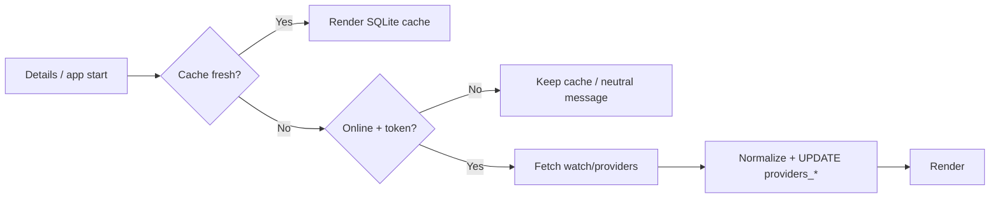

# CineTrack — External API Integration (TMDB & JustWatch)

**Document ID:** CT-API-001\
**Version:** 2.0\
**Status:** Final\
**Project:** CineTrack\
**Last updated:** 2026-11-28

## Revision History

| Version | Date | Summary | Reason |
| --- | --- | --- | --- |
| 2.0 | 2026-11-28 | New document: TMDB endpoints, auth, mapping, image sizes, cache/TTL, errors, provider IDs, deep-link limitations, attribution, token risk | Lecturer consultation + v2 implementation |

---

## 1. Overview

CineTrack uses the **TMDB API v3** as an optional enrichment layer:

- search movies/TV series;
- fetch title details, poster/backdrop paths, genres, year, synopsis;
- fetch legal watch providers per country (data provided by **JustWatch**);
- fetch the provider catalog for Settings.

The app never streams or distributes content. It only opens a legal platform/browser page.

Implementation files:

| File | Responsibility |
| --- | --- |
| `src/config/env.js` | Reads `EXPO_PUBLIC_TMDB_TOKEN`, exposes `isTmdbConfigured` |
| `src/services/tmdbClient.js` | Request wrapper, endpoints, image URL builder |
| `src/services/tmdbMapper.js` | TMDB → CineTrack form/payload |
| `src/services/providerService.js` | Provider normalization, primary pick, link builder, TTL |
| `src/constants/streamingProviders.js` | Verified provider IDs/templates, fallback catalog |
| `src/services/mediaService.js` | Orchestrates duplicate check, details, providers, persistence |

## 2. Authentication

TMDB v3 supports a **Read Access Token** (`Bearer`). The app uses the header, not the query-string API key:

```http
GET /3/search/multi?query=Dune&language=en-US&include_adult=false&page=1
Authorization: Bearer <EXPO_PUBLIC_TMDB_TOKEN>
accept: application/json
```

Token setup:

1. Create a TMDB account.
2. Open <https://www.themoviedb.org/settings/api> and request an API key.
3. Copy the **API Read Access Token (Bearer)**.
4. Put it in `.env`:

   ```env
   EXPO_PUBLIC_TMDB_TOKEN=eyJhbGciOi...
   ```

5. Restart `npx expo start --clear`.

If the token is empty or invalid, `isTmdbConfigured` is false (empty) or requests return 401 (invalid); online features are disabled and manual add still works.

## 3. Endpoints Used

| Purpose | Method & path | Key parameters |
| --- | --- | --- |
| Multi search | `GET /search/multi` | `query`, `language=en-US`, `include_adult=false`, `page=1` |
| Movie details | `GET /movie/{movie_id}` | `language=en-US`, `append_to_response=watch/providers` |
| TV details | `GET /tv/{series_id}` | `language=en-US`, `append_to_response=watch/providers` |
| Movie providers | `GET /movie/{movie_id}/watch/providers` | — |
| TV providers | `GET /tv/{series_id}/watch/providers` | — |
| Movie provider catalog | `GET /watch/providers/movie` | `watch_region={region}`, `language=en-US` |
| TV provider catalog | `GET /watch/providers/tv` | `watch_region={region}`, `language=en-US` |
| Genre verification | `GET /genre/movie/list`, `GET /genre/tv/list` | `language=en-US` |
| Image configuration | `GET /configuration` | — |

Base URL: `https://api.themoviedb.org/3`\
Image base: `https://image.tmdb.org/t/p/{size}{path}`

### 3.1 Search response (shortened)

```json
{
  "page": 1,
  "results": [
    {
      "id": 438631,
      "media_type": "movie",
      "title": "Dune",
      "release_date": "2021-09-15",
      "genre_ids": [878, 12],
      "overview": "Paul Atreides...",
      "poster_path": "/d5NXSklXo0qyIYkgV94XAgMIckC.jpg",
      "backdrop_path": "/jYEW5xZkZk2WTrdbMGAPFuBqbDc.jpg"
    },
    {
      "id": 1396,
      "media_type": "tv",
      "name": "Breaking Bad",
      "first_air_date": "2008-01-20",
      "genre_ids": [18, 80]
    },
    {
      "id": 287,
      "media_type": "person",
      "name": "Brad Pitt"
    }
  ]
}
```

The client strips `person` results; the UI only receives movie/TV.

### 3.2 Details + providers

`append_to_response=watch/providers` adds a `watch/providers` object:

```json
{
  "id": 438631,
  "title": "Dune",
  "release_date": "2021-09-15",
  "genres": [{ "id": 878, "name": "Science Fiction" }],
  "poster_path": "/d5NXSklXo0qyIYkgV94XAgMIckC.jpg",
  "backdrop_path": "/jYEW5xZkZk2WTrdbMGAPFuBqbDc.jpg",
  "watch/providers": {
    "results": {
      "ID": {
        "link": "https://www.themoviedb.org/movie/438631/watch?locale=ID",
        "flatrate": [
          {
            "provider_id": 8,
            "provider_name": "Netflix",
            "logo_path": "/t2yyOv40HZeVlLjYsCsPHnWLk4W.jpg",
            "display_priority": 0
          }
        ],
        "rent": [],
        "buy": []
      }
    }
  }
}
```

If the `watch/providers` block is missing, the service falls back to `GET /movie|tv/{id}/watch/providers`.

### 3.3 Provider catalog

`GET /watch/providers/movie?watch_region=ID` returns a `results` array with `provider_id`, `provider_name`, `logo_path`, `display_priority`, and `display_priorities`. The Settings subscription picker merges the movie and TV catalogs, deduplicates by provider id, and sorts by priority. If offline, it falls back to `KNOWN_PROVIDERS` in `streamingProviders.js`.

## 4. Genre Mapping

TMDB genre **IDs** are mapped to CineTrack’s English genre names. Genre names are not matched by string because TMDB translates them.

| TMDB ID | TMDB meaning | CineTrack |
| --- | --- | --- |
| 28 | Action | Action |
| 12 | Adventure | Adventure |
| 16 | Animation | Animation |
| 35 | Comedy | Comedy |
| 80 | Crime | Crime |
| 99 | Documentary | Documentary |
| 18 | Drama | Drama |
| 10751 | Family | Family |
| 14 | Fantasy | Fantasy |
| 36 | History | History |
| 27 | Horror | Horror |
| 10402 | Music | Music |
| 9648 | Mystery | Mystery |
| 10749 | Romance | Romance |
| 878 | Science Fiction | Sci-Fi |
| 10770 | TV Movie | ignored |
| 53 | Thriller | Thriller |
| 10752 | War | War |
| 37 | Western | Western |
| 10759 | Action & Adventure (TV) | Action, Adventure |
| 10762 | Kids (TV) | Family |
| 10763 | News (TV) | ignored |
| 10764 | Reality (TV) | ignored |
| 10765 | Sci-Fi & Fantasy (TV) | Sci-Fi, Fantasy |
| 10766 | Soap (TV) | ignored |
| 10767 | Talk (TV) | ignored |
| 10768 | War & Politics (TV) | War |

Multiple mapped genres are serialized in `GENRES` order and deduplicated.

## 5. Image Sizes

| Use | Size | Example |
| --- | --- | --- |
| Card poster | `w185` | `https://image.tmdb.org/t/p/w185/...` |
| Detail/custom poster | `w342` | `https://image.tmdb.org/t/p/w342/...` |
| Backdrop | `w780` | `https://image.tmdb.org/t/p/w780/...` |
| Provider logo | `w92` | `https://image.tmdb.org/t/p/w92/...` |

`expo-image` caches these on disk (`cachePolicy="disk"`) and uses `recyclingKey` to avoid showing a previous image in recycled list cells.

## 6. Cache & TTL Strategy

- Metadata and provider groups are persisted in SQLite (`media`).
- `providers_json` stores normalized groups and the TMDB/JustWatch link.
- `providers_region` stores the region used.
- `providers_fetched_at` stores an ISO timestamp.
- TTL = **7 days**. Also stale if `providers_region !== current region` or timestamp is missing.
- On Details open, stale/absent cache refreshes in the background without blocking the UI.
- On app start, up to 20 `TO_WATCH`/`WATCHING` items with stale cache refresh sequentially with ~250 ms spacing.
- Provider refresh updates only `providers_*`; it does **not** change `updated_at`.
- Offline: cached data is displayed; if there is no cache, a neutral message is shown.



## 7. Error Handling

`tmdbClient.tmdbRequest` implements:

| Condition | Behavior |
| --- | --- |
| No token | `TmdbError` code `NOT_CONFIGURED`; online off |
| Timeout (8 s) | `AbortController`; one retry after 300 ms |
| Network failure | One retry; then `OFFLINE` friendly message |
| Aborted by screen/unmount | Code `ABORTED`; ignored by hooks |
| HTTP 401 | Code `AUTH`: “TMDB rejected the token…” |
| HTTP 429 | Code `RATE_LIMIT`: “Too many requests. Try again in a moment.” |
| Other non-2xx | Code `SERVER`: “TMDB request failed…” |
| Empty results | Mapper/UI shows empty state; manual add remains |
| Detail fetch fails during add | Save basic search metadata (degraded mode) |
| Provider refresh fails | Keep cache; log/alert only if manual refresh |

No stack traces are shown to the user. Screens never blank out because of a network error.

## 8. Rate Limiting

- TMDB enforces rate limits; 429 is surfaced with a friendly message.
- No aggressive polling: search is debounced (400 ms), provider refresh is sequential, max 20 items per session, and background failures are silent.
- Concurrent search requests are cancelled when the query changes.

## 9. Region

- Default from `expo-localization` (`getLocales()[0]?.regionCode`), fallback `ID`.
- Stored in `app_settings.region`.
- Changing region re-fetches up to 20 provider caches and treats all caches as stale for later details.
- Provider availability is country-specific; TMDB returns `results[REGION]`.

## 10. Verified Provider IDs & Templates

### 10.1 Provider IDs (verified from TMDB `watch_region=ID` / official examples)

| Provider | TMDB ID | Notes |
| --- | --- | --- |
| Netflix | 8 | ID priority 0 |
| iflix | 160 | ID priority 1 (legacy service) |
| Viu | 158 | ID priority 2 |
| Hotstar (Disney+ Hotstar) | 122 | ID priority 3; no verified search template |
| Apple TV | 2 | ID priority 4 |
| Catchplay | 159 | ID priority 5 |
| Google Play Movies | 3 | ID priority 6 |
| Amazon Prime Video | 119 | ID priority 7 |
| GuideDoc | 100 | ID priority 8 |
| MUBI | 11 | ID priority 9 |
| Netflix Kids | 175 | ID priority 10 |
| Apple TV Plus | 350 | ID priority 12 |
| HBO Go | 425 | ID priority 14 |
| Curiosity Stream | 190 | ID priority 17 |
| Vidio | 489 | ID priority 18 |
| MAX Stream | 483 | ID priority 19 (Indonesian service, not HBO Max) |
| Sun Nxt | 309 | ID priority 34 |
| Crunchyroll | 283 | ID priority 36 |
| Amazon Prime Video | 9 | Used in some regions (e.g. GB/JP) |
| YouTube | 192 | Global; not in the verified ID snapshot |
| HBO Max | 384 | Official examples; no verified template |

WeTV, iQIYI, and Paramount+ were **not present** in the `watch_region=ID` dataset at verification time. If they appear in a future TMDB response, they are displayed automatically using the provider name/logo and the TMDB fallback link. Only providers that actually appear in TMDB data are shown.

### 10.2 URL templates (verified 2026-11-28)

| Provider | Template | HTTP check | Used |
| --- | --- | --- | --- |
| Netflix | `https://www.netflix.com/search?q={title}` | 200 | Yes |
| Amazon Prime Video | `https://www.primevideo.com/search/?phrase={title}` | 200 | Yes (IDs 9, 119) |
| Apple TV | `https://tv.apple.com/search?term={title}` | 200 | Yes (IDs 2, 350) |
| YouTube | `https://www.youtube.com/results?search_query={title}` | 200 | Yes |
| Google Play Movies | `https://play.google.com/store/search?q={title}&c=movies` | 200 | Yes |
| Vidio | `https://www.vidio.com/search?q={title}` | 200 | Yes |
| Viu | `https://www.viu.com/ott/id/en/search?q={title}` | 200 | Yes |
| Crunchyroll | `https://www.crunchyroll.com/search?q={title}` | 403 | No — fallback |
| Hotstar | `https://www.hotstar.com/id/search?q={title}` | 301 → `apps.disneyplus.com` | No — fallback |

`{title}` is always `encodeURIComponent(title)`. A 403/redirect was treated as unverified; those providers use the TMDB/JustWatch link instead. The checks are HTTP-level only; platform apps may still behave differently per device.

## 11. Deep Link Limitations & Future Work

**What TMDB provides:** provider lists per country and a `link` to the TMDB “Where to watch” page (which links out to JustWatch). It does **not** provide a stable per-title deep link for every provider.

**What CineTrack does:**

1. If the provider has a verified search template → open that URL with the encoded title.
2. Otherwise → open the TMDB/JustWatch `link` for that title.
3. If neither exists → alert “Cannot open the link”; no crash.

**Limitations:**

- Search templates open a search results page, not the exact title page.
- Provider URL structures can change; the map must be re-verified.
- A platform app may not register an https deep link; the browser is the fallback.
- Regional provider catalogs change over time.
- TMDB/JustWatch links open a web page, not necessarily the provider app.

**Alternatives (paid/future):**

- **Streaming Availability API** (Streaming Availability API by Movie of the Night) provides per-title deep links per country.
- **Watchmode API** provides availability and deep links.
- A backend proxy can combine TMDB metadata with provider deep links and hide the token.

These are not implemented to keep the academic project free and dependency-light.

## 12. Attribution Requirements

TMDB and JustWatch require attribution. CineTrack displays in Settings → About & Credits and in README:

> This product uses the TMDB API but is not endorsed or certified by TMDB.

> Streaming availability data provided by JustWatch.

The TMDB logo is **not** bundled (text-only attribution) to avoid licensing uncertainty. TMDB/JustWatch names and marks belong to their owners.

## 13. Client Token Risk & Mitigation

`EXPO_PUBLIC_*` values are inlined into the JavaScript bundle. Anyone with the APK can extract the TMDB token and use it against the rate limit/quota.

Accepted because:

- this is an academic project;
- TMDB read tokens are free;
- no user data/payment is exposed.

Production alternatives:

1. Backend proxy (recommended): client calls your server; server adds the TMDB token.
2. Serverless function with rate limiting and per-user quotas.
3. Rotate tokens and monitor usage.
4. Use TMDB’s terms-compliant commercial arrangement where applicable.

## 14. Limitations & Future Work

- Live TMDB integration was not exercised in the development environment because no token was available; pure mapping and provider logic are unit-tested.
- Provider availability can lag behind real-world licensing.
- Deep links are best-effort, not guaranteed per title.
- No caching of TMDB search results (only titles added to the collection).
- No pagination beyond page 1 of search.
- No episode/season metadata; CineTrack tracks titles, not episodes.
- Future: backend proxy, Watchmode/Streaming Availability API, more verified templates, localized metadata, pagination, offline search history.

**End of Document**

Document ID: CT-API-001\
Version: 2.0\
Project: CineTrack
